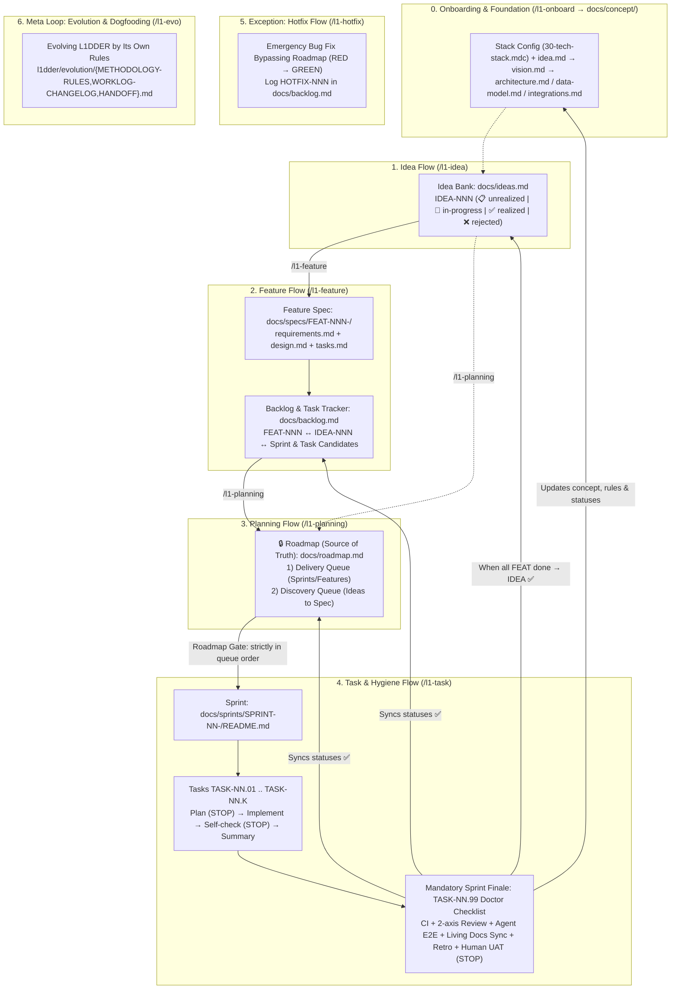

# L1DDER — Development Methodology

> **Philosophy:** The AI agent handles execution mechanics and self-verification. The human owns intent, priorities, and quality acceptance.
> **Core Invariant:** The Roadmap (`docs/roadmap.md`) is the Single Source of Truth. Nothing is built outside the Roadmap (except `/l1-hotfix`).

**L1DDER** defines a closed-loop Spec-driven development lifecycle with AI coding agents: from onboarding (`/l1-onboard`) and raw ideas in the Idea Bank (`/l1-idea`) to specifications in the Backlog (`/l1-feature`), scheduling in the Roadmap (`/l1-planning`), step-by-step sprint execution (`/l1-task`), and mandatory sprint hygiene (`Doctor Checklist`) at the end of every sprint.

---

## 1. Map of `L1DDER` Artifacts & Flows

---

## 2. Project Foundation (`docs/concept/`)

Created once at project start (via `/l1-onboard`) and **mandatorily kept up to date** at the end of every sprint (during the `Doctor Checklist` task):

| Document | Template | Required | Condition |
|----------|----------|:--------:|-----------|
| `idea.md` | [idea-template.md](templates/concept/idea-template.md) | **Required** | Always (high-level product essence & MVP) |
| `vision.md` | [vision-template.md](templates/concept/vision-template.md) | **Required** | Always (technical vision, roles, stack) |
| `architecture.md` | [architecture-template.md](templates/concept/architecture-template.md) | **Required** | When ≥2 components / layers exist |
| `data-model.md` | [data-model-template.md](templates/concept/data-model-template.md) | **Required** | When DB, local store, or config schemas exist |
| `integrations.md` | [integrations-template.md](templates/concept/integrations-template.md) | **Required** | When external services / SDKs exist |
| `api-contracts.md` | [api-contracts-template.md](templates/concept/api-contracts-template.md) | Optional | When HTTP/RPC or module contracts exist |
| ADR in `adrs/` | [adr-template.md](templates/adrs/adr-template.md) | As needed | For significant architectural decisions |

---

## 3. Core Workflows

### Flow 0: Project Onboarding (`/l1-onboard`)
1. Detects `from-scratch` or `existing-code` mode.
2. Configures the stack in `l1dder/rules/30-tech-stack.mdc`, `40-skills-router.mdc`, and `Makefile`, then runs `npx l1dder sync`.
3. Step-by-step creates `docs/concept/*`, `docs/ideas.md`, `docs/backlog.md`, `docs/roadmap.md`, and `docs/README.md` with human `"ok"` approvals.

### Flow 1: Idea Flow (`/l1-idea` → `docs/ideas.md`)
1. Invoked via **`/l1-idea`**.
2. Agent checks `docs/ideas.md` for duplicates, asks decision-tree questions (`grilling`: `❓ Q1 ➡️ Recommendation`), and trims bloat via `ponytail`.
3. After `"ok"`, records `IDEA-NNN` in `docs/ideas.md` with priority (`P0..P3`) and status `📋 unrealized`.

### Flow 2: Feature & Spec Flow (`/l1-feature` → `docs/specs/` + `docs/backlog.md`)
1. Invoked via **`/l1-feature`** for an `IDEA-NNN`.
2. Drafts `docs/specs/FEAT-NNN-<slug>/{requirements,design,tasks}.md` with Deep Modules (`codebase-design`), Pre-agreed Test Seams (`tdd`), and step candidates `FEAT-NNN.01 .. FEAT-NNN.99` (where `.99` is always the mandatory `Doctor Checklist`).
3. After `"ok"`, writes the spec, adds `FEAT-NNN` to `docs/backlog.md` (`📋 in-backlog`), and sets `IDEA-NNN` to `🚧 in-progress`.

### Flow 3: Planning Flow (`/l1-planning` → `docs/roadmap.md`)
1. Invoked via **`/l1-planning`**.
2. Proposes the `Delivery Queue` (sprints `SPRINT-NN`) and `Discovery Queue` (ideas `IDEA-NNN`).
3. After `"ok"`, updates `docs/roadmap.md`, assigns `SPRINT-NN` and `TASK-NN.01..99` in `docs/backlog.md` (`🗓 scheduled`), and creates `docs/sprints/SPRINT-NN-<slug>/README.md`.

### Flow 4: Task & Sprint Hygiene Flow (`/l1-task`)
- **Regular tasks (`TASK-NN.01 .. TASK-NN.K`)** follow the **Two-Approval Rule**:
  1. `Plan` (`plan.md`) → `⛔ STOP #1` (wait for `"ok"`).
  2. `Implement` (strictly within Scope, `Edit → Sanitize → Verify`, vertical TDD at seams).
  3. `Self-check` (DoD commands + `ponytail-review`) → `⛔ STOP #2` (DoD table + 2-line `Ponytail skipped / Risk` footer, wait for `"ok"`).
  4. `Confirm & Record` (`summary.md` + status sync across 4 files).
- **Mandatory final sprint task (`TASK-NN.99` — `Doctor Checklist`):**
  1. *Code & Repo Doctor* (`make ci` + 2-axis `code-review` + `ponytail-audit` + `ponytail-debt`).
  2. *Agent E2E Verification* (`make test-e2e` + live scenario walk-through).
  3. *Living Docs Sync + `retro`* (mandatory update of `docs/concept/*`, `docs/specs/*`, `docs/adrs/*`, and `l1dder/rules/*.mdc`).
  4. *Human UAT* (step-by-step manual test guide for the human at `⛔ STOP #2`, followed by cascading closure `TASK-NN.99 ✅ → SPRINT-NN ✅ → FEAT-NNN ✅ → IDEA-NNN ✅`).

### Flow 5: Hotfix Exception (`/l1-hotfix`)
Reproduces an urgent bug first (`RED Gate` — `diagnosing-bugs`), gets `"ok"` on a concise chat plan, applies the minimal fix (`GREEN` + `make ci`), and logs `HOTFIX-NNN` in `docs/backlog.md`.
