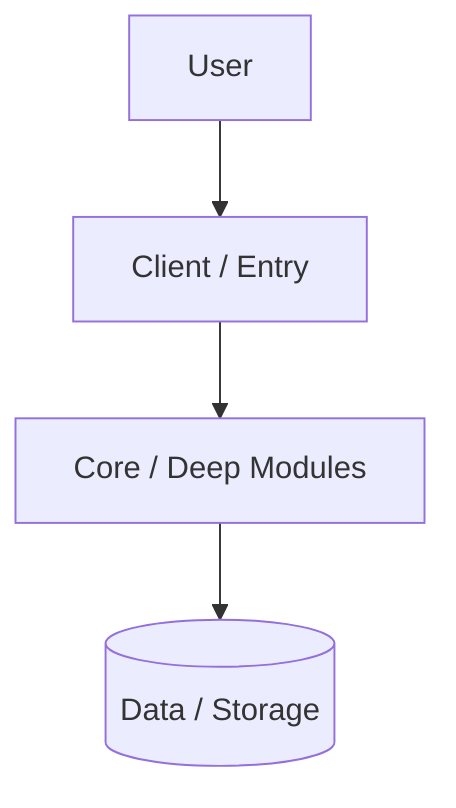
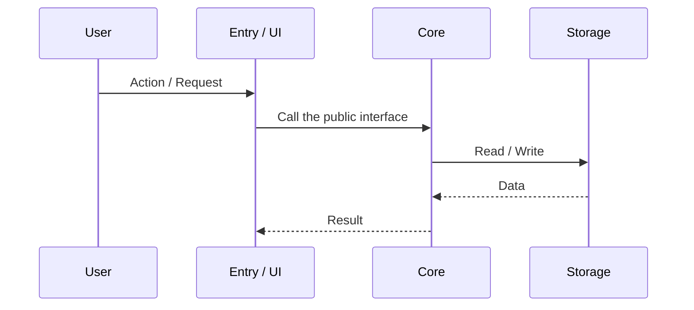

# System Architecture

> A high-level description of the components, deep modules and data flows.
> The product vision is in [vision.md](vision.md). The data model is in [data-model.md](data-model.md). Fill in the Technologies column at onboarding stage 5, after the stack is chosen in `l1dder/rules/30-tech-stack.mdc`.

---

## 1. Context & Container Diagram

---

## 2. Components & Deep Modules (`Deep Modules`)

| Component / Module | Public Interface (`Seam`) | Responsibility (what is hidden inside) | What it does NOT do | Technologies (stage 5) |
|--------------------|---------------------------|----------------------------------------|---------------------|------------------------|
| **[Module 1]** | `[functions / API]` | `[internal logic]` | `[what another module owns]` | `[after the stack is chosen]` |
| **[Module 2]** | `[functions / API]` | `[internal logic]` | `[what another module owns]` | `[after the stack is chosen]` |

---

## 3. Main Data Flows

---

## 4. Run, Build & Verify

- Run locally: `make dev`
- Full quality check: `make ci` (`lint` + `typecheck` + `test` + `build`)
