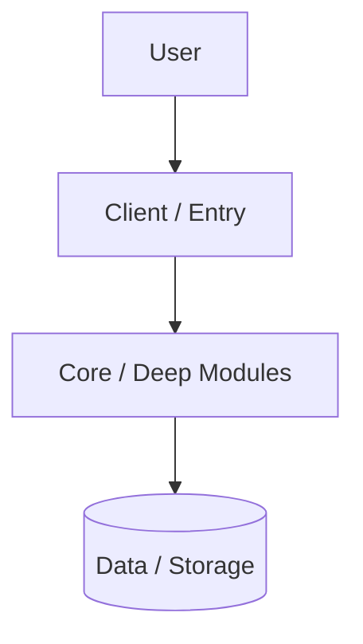

# System Architecture

## 1. Container Diagram

## 2. Deep Modules & Public Seams (`codebase-design`)
| Module | Public Interface (`Seam`) | Hidden Responsibility | Tech |
|--------|---------------------------|-----------------------|------|
| **[Module 1]** | `[functions / API]` | `[internal logic]` | `[stack]` |

## 3. Local Development & CI Verification
- Local dev: `make dev`
- Full CI check: `make ci` (`lint` + `typecheck` + `test` + `build`)
