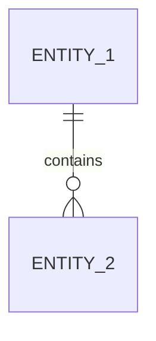

# Data Model

## 1. Logical Entities
### [Entity 1]
| Field | Type | Description |
|-------|------|-------------|
| `id` | `string` / `number` | Unique identifier |
| `[field]` | `[type]` | `[description]` |

## 2. ER Diagram

## 3. Physical Storage & Boundary Validation
| Rule | Value |
|------|-------|
| Identifiers | Stable string slugs / UUIDs |
| Boundary Validation | Strict schema validation at read/write (`Zod` / `Pydantic` / JSON Schema / DB constraints) |
| Storage | `[Selected storage & rationale]` |
