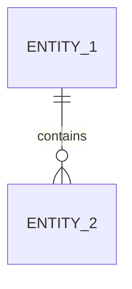

# Data Model

> The logical model of domain entities and the physical model of storage and configuration (JSON/Zod schemas, local storage or database tables).

---

## 1. Logical Entities

### [Entity 1]

[1–2 sentences: what it is in domain terms. The name matches the term in the project glossary.]

| Field | Type | Description |
|-------|------|-------------|
| `id` | `string` / `number` | Unique identifier |
| `[field]` | `[type]` | `[description]` |

---

## 2. ER Diagram

---

## 3. Physical Storage & Schema Validation

| Rule | Value |
|------|-------|
| Identifiers | Stable string IDs / UUIDs |
| Boundary validation | Strict schema validation on read and write (`Zod` / `Pydantic` / JSON Schema / DB constraints) |
| Storage | `[The chosen storage and why]` |
