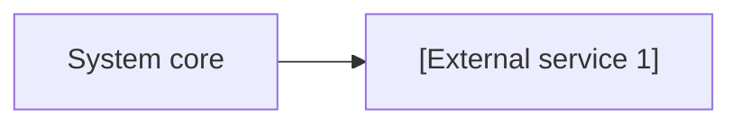

# External Integrations

> External services, SDKs and APIs the system works with.

---

## 1. Integration Registry

| Service / SDK | Purpose | Direction | Protocol / Package | Criticality |
|---------------|---------|-----------|--------------------|-------------|
| **[Service 1]** | `[What it is used for]` | `In / Out` | `HTTPS REST / SDK` | `MVP / Optional` |

---

## 2. Integration Diagram

---

## 3. Dependencies, Limits & Fallback Behaviour

| Integration | Risk (outage / limits) | Mitigation / Fallback |
|-------------|------------------------|-----------------------|
| **[Service 1]** | `[Risk]` | `[How the system behaves when it fails]` |
