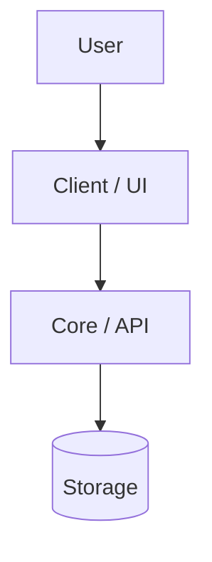

# Technical Vision

## 1. System Overview
[2–3 sentences describing the system core.]

## 2. Roles & Key User Scenarios
| Role | Description |
|------|-------------|
| **[Role 1]** | [Responsibilities & scenarios] |

## 3. High-Level Architecture

## 4. Principles & Tech Stack
- **Ponytail & Deep Modules:** minimal code, deep modules with clean public seams (`Seams`).
- **KISS & YAGNI:** build only what the active Roadmap sprint requires.

| Area | Choice |
|------|--------|
| Language & Runtime | [Tech + version] |
| Framework / UI | [Tech + version] |
| Data / Validation | [Tech + version] |
| Testing & Quality | [Tech + version] |
