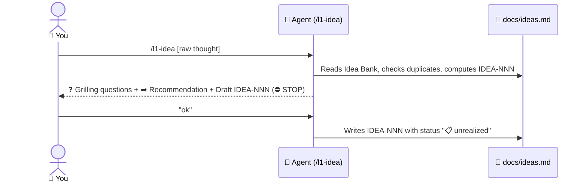
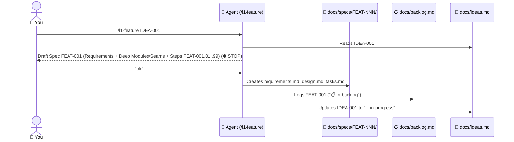
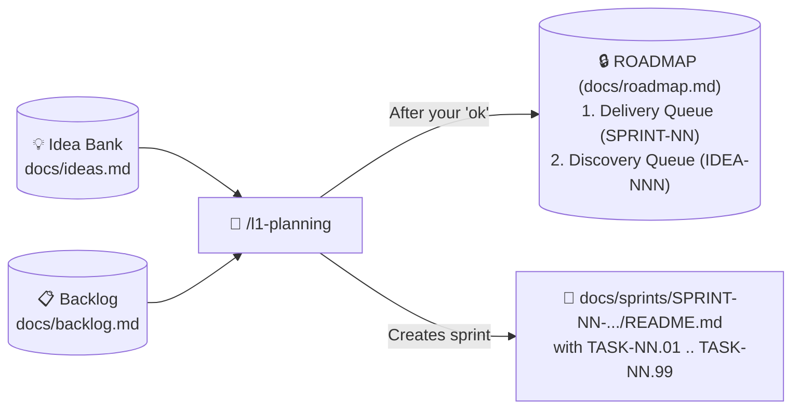
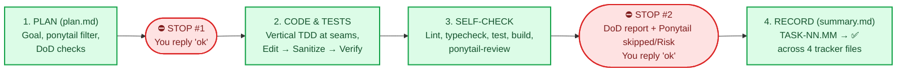
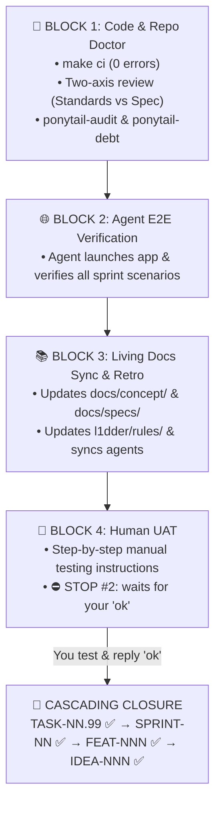
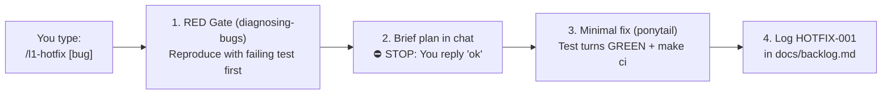
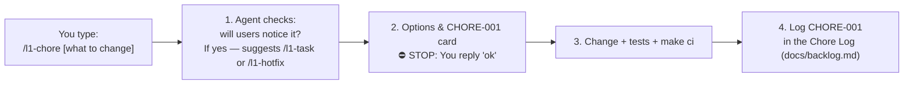
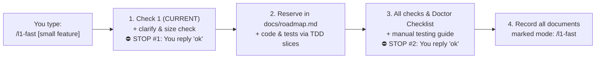

# 🔍 2. Deep Dive into All `L1DDER` Flows

> ⬅️ Back to [Quickstart (01-QUICKSTART.md)](./01-QUICKSTART.md) | ➡️ Next: [One-Page Cheatsheet (03-CHEATSHEET.md)](./03-CHEATSHEET.md)

---

## 🧭 Button 0: `/l1-onboard` — Project Onboarding by Stages

**When to press:** Once, right after `npx l1dder init` (in a new empty project or in an existing repository with code).
- The agent detects `from-scratch` or `existing-code` mode and walks you through six stages, one file at a time: idea → vision → architecture → data model → stack → Idea Bank and roadmap.
- At each stage it asks up to 7 questions with ready recommendations, reviews your answers and asks: "Move on or another round?". A stage file is written only after your "ok".
- The agent proposes the stack (`l1dder/rules/30-tech-stack.mdc`, `Makefile`) at stage 5, once the architecture and the data model are clear. In a project with code it takes the stack and other facts from the code itself.
- If you mention something about the architecture or the data early, the agent offers to record it in the right file so nothing gets lost.

---

## 💡 Button 1: `/l1-idea` — Idea Birth & Refinement

---

## 📐 Button 2: `/l1-feature` — Feature Specification & Backlog Slicing

---

## 🔒 Button 3: `/l1-planning` — Roadmap Scheduling (Source of Truth)

**Rejecting the current sprint:** If you decide to abandon the sprint at `1 (CURRENT)`, ask `/l1-planning` to reject it. The agent shows the sprint commits and uncommitted changes (`⛔ STOP`), and after your `"ok"` rolls back the sprint code via `git revert` without rewriting history, keeps the sprint documents with status `❌ rejected` as a record, and frees `1 (CURRENT)`.

---

## ⚙️ Button 4: `/l1-task` — Task Execution & Mandatory `Doctor Checklist`

### Part A: Regular Task (`TASK-NN.01 .. TASK-NN.K`) — Two-Approval Rule

### Part B: 🩺 Mandatory Sprint Finale — `TASK-NN.99` (`Doctor Checklist`)

---

## 🚑 Button 5: `/l1-hotfix` — Emergency Bug Fix Bypassing Roadmap

---

## 🧹 Button 6: `/l1-chore` — Changes to the Project Itself

**When to use:** When you need to change not what your users see, but **the project itself**: its "back kitchen". For example:
- change how you work with git: how branches and commits are named, what is checked before a push;
- set up automatic checks in CI;
- update libraries and dependencies;
- fix the `Makefile`, build scripts or tests;
- change the rules for your AI agent.

These changes need no idea, spec or sprint. The agent shows once what it will do and how, you answer "ok", and the change is logged as one line in `docs/backlog.md`. You can also skip the command and just write "let's make a chore change...".

**How it differs from `/l1-hotfix`:** `/l1-hotfix` fixes what broke for the product's users. `/l1-chore` changes what you and the agent use while building the product.

---

## ⚡ Button 7: `/l1-fast` — Fast Mode for a Small Product Feature

**When to use:** When **no sprint is active** (row `1 (CURRENT)` in `docs/roadmap.md` is empty) and you want to build **a small product feature** without stepping through `/l1-idea` → `/l1-feature` → `/l1-planning` → `/l1-task` separately.

> ⚠️ **Core rule:** `/l1-fast` is **strictly human-invoked** — the agent is **forbidden** from running or picking `/l1-fast` on its own initiative. Unless you explicitly type `/l1-fast`, the agent always follows the regular path.

- **When a sprint is already active (`1 (CURRENT)` is occupied):** the agent refuses outright without changing any file, and asks you to either finish the current sprint via `/l1-task` or reject it with rollback via `/l1-planning`.
- **Size check:** if the feature is too large (more than three tasks or more than one sprint; a new data model, external integration, or ADR; breaking changes; needs a separate requirements review), the agent warns you and suggests `/l1-idea` → `/l1-feature`.
- **Two stops instead of four, zero skipped checks:** you reply "ok" twice — on the decision card before any code (`⛔ STOP #1`) and after manual testing of the finished result (`⛔ STOP #2`). In between, the agent reserves the IDs at `1 (CURRENT)` in the roadmap, writes code via TDD slices, commits each task, and runs **every** check from the regular flow and `TASK-NN.99` (`make ci`, `ponytail-review`, two-axis `code-review`, `ponytail-audit`, `ponytail-debt`, E2E, docs sync, and `retro`).
- **Honest registries after the code:** after your second "ok", the agent records `docs/ideas.md`, `docs/backlog.md`, the spec in `docs/specs/`, and the sprint and tasks marked `Mode | /l1-fast`, and moves the sprint to `Completed Sprints`.

**How the three fast buttons differ:**
- `/l1-chore` — change **the project itself** (git rules, CI, libraries, `Makefile`) while the product stays unchanged;
- `/l1-hotfix` — urgently fix **a bug** in the product;
- `/l1-fast` — build **a small new product feature** when no sprint is active (strictly human-invoked).
