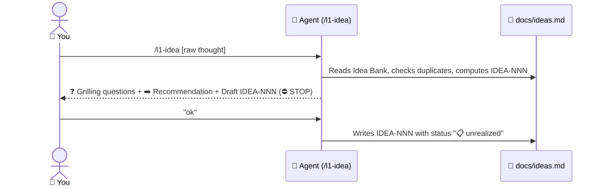
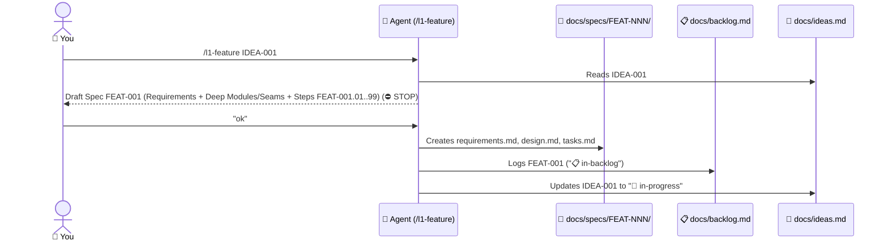
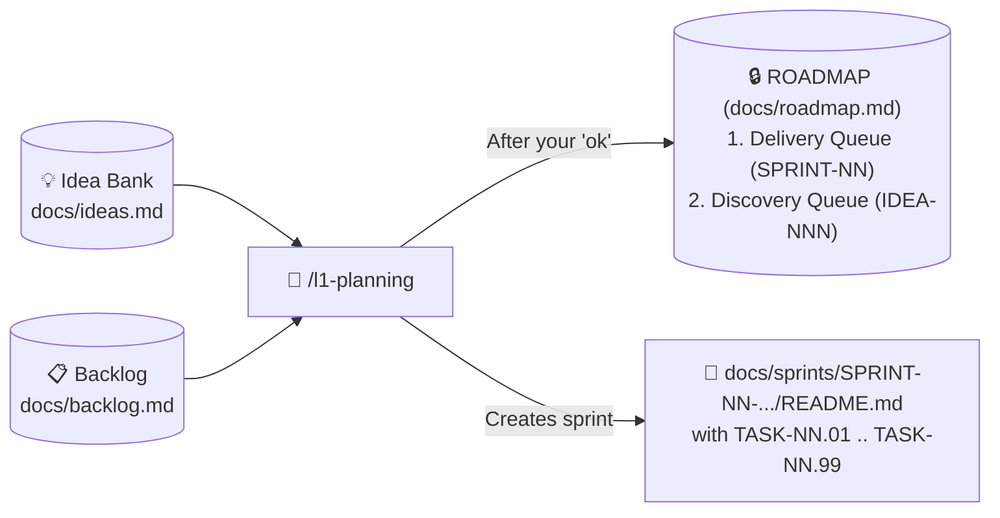
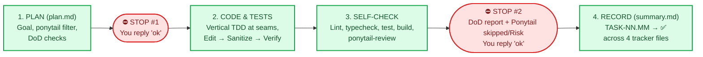
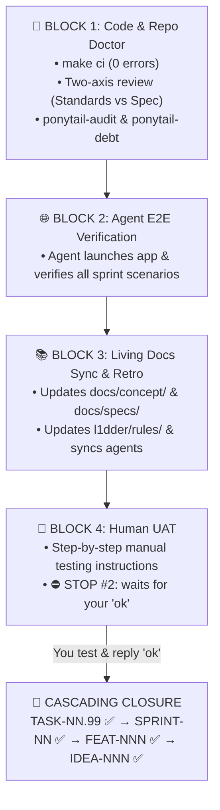
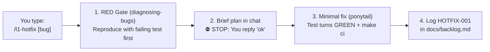

# 🔍 2. Deep Dive into All `L1DDER` Flows

> ⬅️ Back to [Quickstart (01-QUICKSTART.md)](./01-QUICKSTART.md) | ➡️ Next: [One-Page Cheatsheet (03-CHEATSHEET.md)](./03-CHEATSHEET.md)

---

## 🧭 Button 0: `/l1-onboard` — Project Onboarding & Stack Setup
Run once after `npx l1dder init`. Detects `from-scratch` or `existing-code` mode, configures `l1dder/rules/30-tech-stack.mdc` and `Makefile`, syncs agent rules, and creates `docs/concept/`, `docs/ideas.md`, `docs/backlog.md`, and `docs/roadmap.md`.

---

## 💡 Button 1: `/l1-idea` — Idea Birth & Refinement

---

## 📐 Button 2: `/l1-feature` — Feature Specification & Backlog Slicing

---

## 🔒 Button 3: `/l1-planning` — Roadmap Scheduling (Source of Truth)

---

## ⚙️ Button 4: `/l1-task` — Task Execution & Mandatory `Doctor Checklist`

### Part A: Regular Task (`TASK-NN.01 .. TASK-NN.K`) — Two-Approval Rule

### Part B: 🩺 Mandatory Sprint Finale — `TASK-NN.99` (`Doctor Checklist`)

---

## 🚑 Button 5: `/l1-hotfix` — Emergency Bug Fix Bypassing Roadmap

