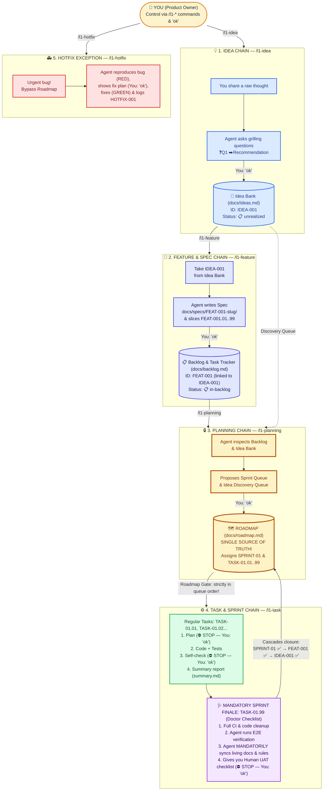
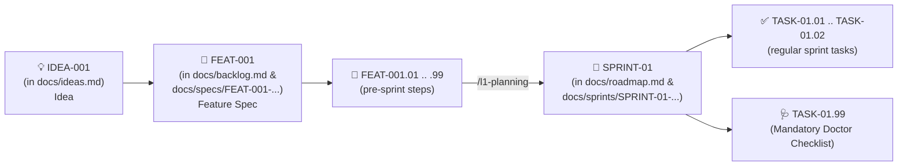

# 🚀 L1DDER — Human Guide (Vibe-Coder Friendly)

Welcome to **L1DDER**!
This guide is written in plain language. Even if you don't write code by hand and build products through chat with AI coding agents (**Cursor, Claude Code, Codex, Windsurf, Copilot, OpenCode, Cline**), in 3 minutes you'll see how to build complex, reliable software that doesn't fall apart on day three.

---

## Guide Navigation

| Document | What It Covers | Read Time |
|----------|----------------|:---------:|
| **[0. Main Map (You are here)](./README.md)** | Core idea, **visual map of all flows**, nested ID chain, and the 3 control screens | 3 min |
| **[1. Quickstart & Live Walkthrough](./01-QUICKSTART.md)** | One-command setup `npx l1dder init` + real chat walkthrough from idea to finished sprint | 5 min |
| **[2. Deep Dive into `/l1-*` Commands](./02-FLOWS-IN-DETAIL.md)** | Inside `/l1-onboard`, `/l1-idea`, `/l1-feature`, `/l1-planning`, `/l1-task` (`Doctor Checklist`), and `/l1-hotfix` | 7 min |
| **[3. One-Page Cheatsheet & FAQ](./03-CHEATSHEET.md)** | "What to press when..." table, all statuses, and FAQ | 2 min |

---

## Why `L1DDER`?

In ordinary vibe-coding, you ask *"Build me a dashboard"*, the AI writes 1,000 lines of code, and three days later adding a single button breaks half the app because the agent forgot yesterday's context.

In **L1DDER**, roles are strictly separated:
- 👤 **You are the Product Owner & Final Reviewer.** You bring ideas, set priorities, reply **"ok"** at decision checkpoints, and test the finished result.
- 🤖 **The AI Agent is your Engineering Team with a Built-in Tech Lead.** It asks smart decision-tree questions with recommendations, writes specs, writes lean code (`ponytail`), runs tests, and keeps documentation in sync.

You control the entire lifecycle with **6 slash commands**:
0. `/l1-onboard` — run once at project start to configure your tech stack and create `docs/`.
1. `/l1-idea` — capture and refine an idea into the Idea Bank.
2. `/l1-feature` — turn an idea into a technical specification and slice it into Backlog tasks.
3. `/l1-planning` — order the Roadmap queue (what we build now vs. next).
4. `/l1-task` — tell the agent "Execute the next task on the Roadmap!".
5. `/l1-hotfix` — emergency button "Fix this bug right now bypassing the queue!".
*(Plus `/l1-evo` to evolve the methodology itself or save `HANDOFF.md`).*

---

## 🗺 Visual Map of `L1DDER`: 5 Core Chains

---

## 🔗 Nested ID Chain: Why the Agent Never Loses Context

Every document stores all parent IDs in its header **ID Passport** — like nested Russian dolls:

---

## 📺 Three Control Screens in `docs/`

| File | Plain-Language Purpose | Managed By |
|------|------------------------|------------|
| **`docs/ideas.md`** | **💡 Idea Bank.** All your ideas with priorities (`P0..P3`) and statuses (`📋 unrealized`, `🚧 in-progress`, `✅ realized`, `❌ rejected`). | `/l1-idea` |
| **`docs/backlog.md`** | **📋 Backlog & Task Tracker.** All specified features (`FEAT-001`), their sprints, tasks, and the emergency hotfix log (`HOTFIX-001`). | `/l1-feature`, `/l1-task`, `/l1-hotfix` |
| **`docs/roadmap.md`** | **🔒 Roadmap (Source of Truth).** Which sprint is active right now (`1 CURRENT`), which is `2 NEXT`, and which idea is next for spec grooming. | `/l1-planning` |

---

👉 **Next:** open **[01-QUICKSTART.md](./01-QUICKSTART.md)** for a live step-by-step chat walkthrough!
