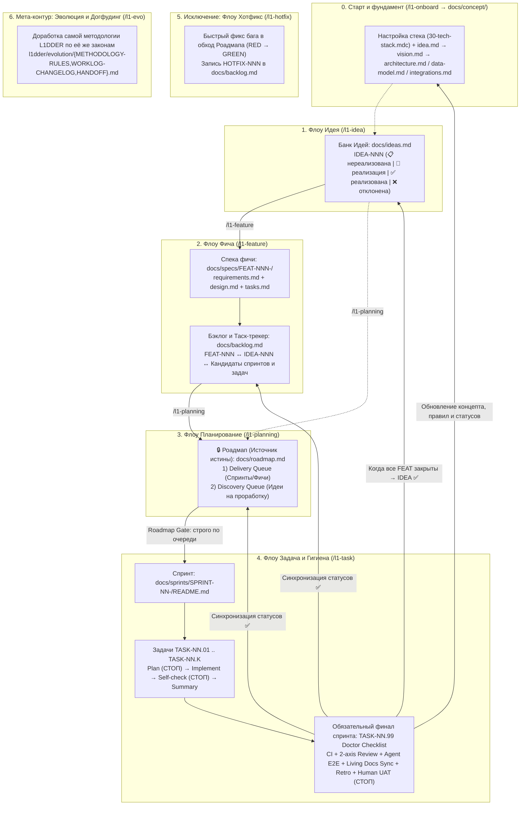

# L1DDER — Методология разработки

> **Философия:** Агент занимается механикой исполнения и самопроверкой. Человек занимается намерением, приоритетами и приёмкой качества.
> **Главный инвариант:** Роадмап (`docs/roadmap.md`) — единственный источник истины. Мы ничего не делаем в обход Роадмапа (кроме `/l1-hotfix`).

**L1DDER** описывает замкнутый цикл Spec-driven разработки с AI-агентами: от онбординга (`/l1-onboard`) и сырой идеи в Банке Идей (`/l1-idea`) до проработанной спеки в Бэклоге (`/l1-feature`), планирования в Роадмапе (`/l1-planning`), пошаговой реализации в спринтах (`/l1-task`) и обязательной ревизии здоровья проекта (`Doctor Checklist`) в конце каждого спринта.

---

## 1. Карта артефактов и потоков `L1DDER`



---

## 2. Базовый фундамент проекта (`docs/concept/`)

Заполняется один раз на старте проекта (через `/l1-onboard`) и **обязательно поддерживается в актуальном состоянии** в конце каждого спринта (в рамках гигиенической задачи `Doctor Checklist`):

| Документ | Шаблон | Обязательность | Условие |
|----------|--------|:--------------:|---------|
| `idea.md` | [idea-template.md](templates/concept/idea-template.md) | **Обязательно** | Всегда (верхнеуровневая суть проекта) |
| `vision.md` | [vision-template.md](templates/concept/vision-template.md) | **Обязательно** | Всегда (техническое видение, роли, стек) |
| `architecture.md` | [architecture-template.md](templates/concept/architecture-template.md) | **Обязательно** | При наличии ≥2 компонентов / слоёв |
| `data-model.md` | [data-model-template.md](templates/concept/data-model-template.md) | **Обязательно** | При наличии БД, локального стора или схем конфигов |
| `integrations.md` | [integrations-template.md](templates/concept/integrations-template.md) | **Обязательно** | При наличии внешних сервисов / SDK |
| `api-contracts.md` | [api-contracts-template.md](templates/concept/api-contracts-template.md) | Опционально | При наличии API / межмодульных контрактов |
| ADR в `adrs/` | [adr-template.md](templates/adrs/adr-template.md) | По необходимости | При значимом архитектурном решении |

---

## 3. Рабочие потоки `L1DDER`

### Поток 0: Онбординг проекта (`/l1-onboard`)
Единая точка старта после `npx l1dder init`:
1. Определяет режим (`from-scratch` для нового проекта или `existing-code` для существующего репозитория).
2. Настраивает проектный стек в `l1dder/rules/30-tech-stack.mdc`, маршрутизатор скиллов в `l1dder/rules/40-skills-router.mdc` и `Makefile`, после чего синхронизирует правила агентов (`npx l1dder sync`).
3. Пошагово с подтверждением (`ок`) создаёт `docs/concept/*`, `docs/ideas.md`, `docs/backlog.md`, `docs/roadmap.md` и `docs/README.md`.

---

### Поток 1: Флоу «Идея» (`/l1-idea` → `docs/ideas.md`)

Когда появляется любая продуктовая или техническая задумка:
1. Вызывается скилл **`/l1-idea`**.
2. Агент проверяет `docs/ideas.md` на пересечения и помогает развить идею: задаёт уточняющие вопросы по дереву решений (`grilling`: `❓ Q1 ➡️ Рекомендация`), предлагает варианты с опорой на факты и отсекает лишнее по принципу `ponytail`.
3. После согласования («ок») идея добавляется в **Банк Идей (`docs/ideas.md`)**:
   - Присваивается уникальный код `IDEA-NNN`.
   - Задаётся приоритет (`P0` / `P1` / `P2` / `P3`).
   - Устанавливается статус `📋 нереализована`.

**Статусная модель идеи (`IDEA-NNN`):**
- `📋 нереализована` — лежит в банке идей, ждёт проработки.
- `🚧 реализация` — по идее создана фича (`FEAT-NNN`) и/или идут работы в спринтах.
- `✅ реализована` — все связанные с идеей фичи полностью реализованы.
- `❌ отклонена` — идея отвергнута (с фиксацией причины).

Шаблон: [ideas-template.md](templates/ideas/ideas-template.md)

---

### Поток 2: Флоу «Фича» (`/l1-feature` → `docs/specs/` + `docs/backlog.md`)

Превращает идею из Банка Идей в проработанную спецификацию и декомпозированную запись в Бэклоге:
1. Вызывается скилл **`/l1-feature`** (на вход подаётся `IDEA-NNN` из очереди проработки Роадмапа или выбранная пользователем; если идеи ещё не было в `docs/ideas.md` — она автоматически создаётся).
2. Агент совместно с пользователем создаёт спецификацию в `docs/specs/FEAT-NNN-<slug>/`:
   - `requirements.md` — User Stories + Acceptance Criteria (`GIVEN/WHEN/THEN`), границы scope.
   - `design.md` — архитектура фичи, глубокие модули (`Deep Modules`), согласованные публичные швы тестирования (`Pre-agreed Test Seams`), схемы данных/конфигов.
   - `tasks.md` — груминг фичи на кандидаты спринтов и атомарных задач (`FEAT-NNN.01 .. FEAT-NNN.99`), где **последней задачей каждого спринта обязательно закладывается `FEAT-NNN.99: Гигиена спринта и Doctor Checklist`**.
3. После согласования («ок»):
   - Фича записывается в **Бэклог и Таск-трекер (`docs/backlog.md`)** с кодом `FEAT-NNN`, **обязательной ссылкой на `IDEA-NNN`**, ссылкой на спеку, приоритетом, статусом `📋 в бэклоге` и списком кандидатов спринтов/задач.
   - Статус идеи `IDEA-NNN` в `docs/ideas.md` переводится в `🚧 реализация`.

**Статусная модель фичи (`FEAT-NNN`):**
- `📝 проработка` — спека в работе.
- `📋 в бэклоге` — спека утверждена, нарезана на кандидаты спринтов, ждёт планирования в Роадмап.
- `🗓 запланирована` — поставлена в очередь `docs/roadmap.md` и привязана к `SPRINT-NN`.
- `🚧 реализация` — спринт фичи в активной разработке.
- `✅ реализована` — все спринты фичи (включая `Doctor Checklist`) закрыты.
- `❌ отклонена` — отменена.

Шаблоны: [spec-template.md](templates/specs/spec-template.md), [backlog-template.md](templates/backlog/backlog-template.md)

---

### Поток 3: Флоу «Планирование» (`/l1-planning` → `docs/roadmap.md`)

**Роадмап (`docs/roadmap.md`) — единый источник истины проекта.**
1. Вызывается скилл **`/l1-planning`**.
2. Агент анализирует `docs/ideas.md`, `docs/backlog.md` и текущий `docs/roadmap.md` и предлагает план:
   - **Очередь реализации (Delivery Queue):** в какой последовательности запускаем спринты (`SPRINT-NN`) по готовым фичам (`FEAT-NNN`).
   - **Очередь проработки (Discovery Queue):** в какой последовательности прорабатываем идеи (`IDEA-NNN`) в новые спеки через `/l1-feature`.
3. После согласования («ок»):
   - Обновляется `docs/roadmap.md`.
   - В `docs/backlog.md` кандидаты спринтов получают номера `SPRINT-NN` и `TASK-NN.01 .. TASK-NN.99`, а статус фич переводится в `🗓 запланирована`.
   - Для ближайшего спринта создаётся `docs/sprints/SPRINT-NN-<slug>/README.md` (с обязательной финальной задачей `TASK-NN.99`).

**Железное правило (Roadmap Gate):**
> Никакая задача не берётся в разработку, если она не стоит текущей в `docs/roadmap.md`. Чтобы поменять план — сначала вызываем `/l1-planning`, меняем `docs/roadmap.md`, затем вызываем `/l1-task`.

Шаблон: [roadmap-template.md](templates/roadmap/roadmap-template.md)

---

### Поток 4: Флоу «Задача и Гигиена спринта» (`/l1-task`)

Выполняет задачи текущего активного спринта из `docs/roadmap.md`.

#### Стандартная задача (`TASK-NN.01 .. TASK-NN.K`)
Проходит 4 фазы с **правилом двух согласований**:
1. **Plan:** создание `plan.md` (паспорт ID, цель, фильтр `ponytail`, шаги, DoD, артефакты, scope, прочитанные скиллы из `40-skills-router.mdc`).
   - ⛔ **СТОП №1** — показ плана и ожидание «ок».
2. **Implement:** работа строго в `Scope` по циклу `Edit → Sanitize → Verify`.
3. **Self-check:** выполнение всех проверок DoD агентом + `ponytail-review`.
   - ⛔ **СТОП №2** — показ отчёта DoD + 2-строчного футера `Ponytail skipped / Risk` и ожидание «ок».
4. **Confirm & Record:** создание `summary.md`, синхронизация статусов в `sprint README.md`, `tasks.md`, `docs/backlog.md` и `docs/roadmap.md`.

#### Обязательная финальная задача каждого спринта: Гигиена и `Doctor Checklist` (`TASK-NN.99`)
Каждый спринт **строго завершается** задачей `TASK-NN.99` (`tasks/TASK-NN.99-doctor/`) по шаблону [doctor-checklist-template.md](templates/tasks/doctor-checklist-template.md):
1. **Code & Repo Doctor:** прогон `make ci` + двухосевой `code-review` (`Standards` vs `Spec`) + аудит `ponytail-audit` + сбор `shortcut:` через `ponytail-debt`.
2. **Максимальный E2E-прогон агентом:** автотесты `make test-e2e` + живой прогон всех пользовательских сценариев спринта агентом (в браузере/CLI/API в зависимости от типа продукта).
3. **Обязательное обновление долгосрочной документации (Living Docs Sync + `retro`):**
   - актуализация `docs/concept/*` (`vision.md`, `architecture.md`, `data-model.md`, `integrations.md`, `api-contracts.md`);
   - актуализация спеки `docs/specs/FEAT-NNN-<slug>/` под фактическую реализацию;
   - актуализация правил `l1dder/rules/*.mdc` (с синхронизацией через `npx l1dder sync`) и ADR (`docs/adrs/`).
4. **Приёмочное тестирование человеком (Human UAT):**
   - Агент готовит пошаговый сценарий ручного тестирования для человека и ждёт на ⛔ **СТОП №2**.
   - После ручной проверки и «ок» от человека спринт закрывается (`✅ реализована`), а статусы каскадно обновляются в `docs/backlog.md`, `docs/roadmap.md` и `docs/ideas.md`.

---

### Поток 5: Исключение — Флоу «Хотфикс» (`/l1-hotfix`)

Для срочных багов, требующих немедленного исправления в обход очереди Роадмапа:
1. Вызывается скилл **`/l1-hotfix`**.
2. Агент проходит `RED Reproduction Gate` (`diagnosing-bugs` — воспроизводит баг падающим тестом/командой) и предлагает краткий план фикса в чате (1 точка согласования «ок»).
3. Выполняет минимальное исправление (`ponytail`), убеждается в переходе теста в `GREEN` + `make ci` и фиксирует запись `HOTFIX-NNN` (со связью на `FEAT-NNN` / `TASK-NN.MM`) в разделе «Журнал Хотфиксов» внутри `docs/backlog.md`.

---

### Поток 6: Мета-контур — Эволюция и Догфудинг самой методологии (`/l1-evo` → `l1dder/evolution/`)

Сама методология `L1DDER` развивается по принципу **100% догфудинга** (подчиняется собственным правилам двух согласований, фильтру `ponytail`, опросу `grilling`, глубоким модулям `codebase-design` и двухосевому ревью `code-review`):
- **Правила эволюции:** [`l1dder/evolution/METHODOLOGY-RULES.md`](evolution/METHODOLOGY-RULES.md) (разделение `Core vs Stack`, неприкосновенность цепочки ID, матрица полной синхронизации `Single Change = Full Sync`).
- **Журнал изменений и решений:** [`l1dder/evolution/WORKLOG-CHANGELOG.md`](evolution/WORKLOG-CHANGELOG.md).
- **Слепок для передачи контекста между сессиями и проектами:** [`l1dder/evolution/HANDOFF.md`](evolution/HANDOFF.md).

---

## 4. Полная структура `docs/` в проекте на `L1DDER`

```
docs/
├── README.md                      # навигатор по всей документации продукта
│
├── concept/                       # долгосрочный фундамент (обновляется в конце каждого спринта)
│   ├── idea.md                    # верхнеуровневая суть продукта
│   ├── vision.md                  # техническое видение, роли, стек
│   ├── architecture.md            # диаграммы, ответственность слоёв/компонентов
│   ├── data-model.md              # схема данных / конфигов / состояния
│   ├── integrations.md            # внешние сервисы, SDK, риски
│   └── api-contracts.md           # контракты API / модулей (если применимо)
│
├── adrs/                          # архитектурные решения (ADR)
│   └── ADR-0001-<slug>.md
│
├── ideas.md                       # 💡 БАНК ИДЕЙ (IDEA-NNN: статусы и приоритеты) — /l1-idea
├── backlog.md                     # 📋 БЭКЛОГ И ТАСК-ТРЕКЕР (FEAT-NNN, SPRINT-NN, TASK-NN.M, HOTFIX-NNN) — /l1-feature
├── roadmap.md                     # 🔒 РОАДМАП (Источник истины: Delivery Queue + Discovery Queue) — /l1-planning
│
├── specs/                         # функциональные спецификации фич — /l1-feature
│   └── FEAT-001-<slug>/
│       ├── requirements.md        # user stories + acceptance criteria (GIVEN/WHEN/THEN)
│       ├── design.md              # архитектура фичи, публичные швы (Seams), схемы
│       └── tasks.md               # груминг на спринты и задачи (+ обязательный Doctor Checklist)
│
└── sprints/                       # спринты и задачи реализации — /l1-planning, /l1-task
    └── SPRINT-01-<name>/
        ├── README.md              # цель, DoD спринта, список задач, итог
        └── tasks/
            ├── TASK-01.01-<task>/
            │   ├── plan.md        # до: паспорт ID, цель, шаги, DoD, артефакты, scope
            │   └── summary.md     # после: что сделано, решения, чек-лист синхронизации ID
            └── TASK-01.99-doctor/ # обязательная финальная гигиеническая задача спринта
                ├── plan.md        # по шаблону doctor-checklist-template.md
                └── summary.md     # отчёт E2E, обновлённой доки и итогов Human UAT
```
