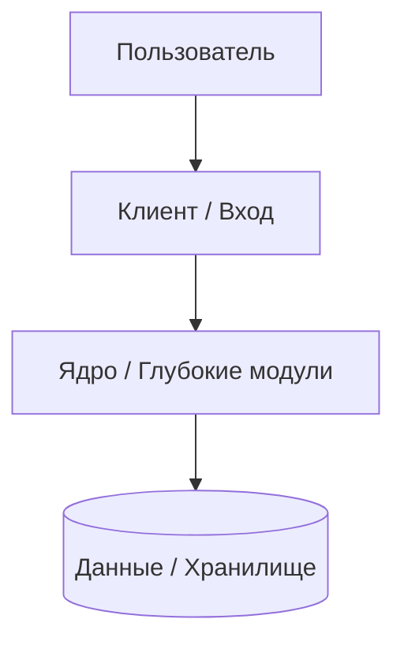
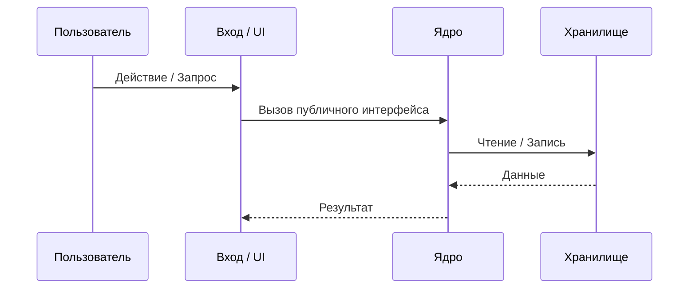

# Архитектура системы

> Высокоуровневое описание компонентов, глубоких модулей и потоков данных.
> Продуктовое видение — в [vision.md](vision.md). Модель данных — в [data-model.md](data-model.md).

---

## 1. Контекст и диаграмма контейнеров

---

## 2. Компоненты и глубокие модули (`Deep Modules`)

| Компонент / Модуль | Публичный интерфейс (`Seam`) | Ответственность (что скрыто внутри) | Технологии |
|--------------------|------------------------------|-------------------------------------|------------|
| **[Модуль 1]** | `[функции / API]` | `[внутренняя логика]` | `[стек]` |
| **[Модуль 2]** | `[функции / API]` | `[внутренняя логика]` | `[стек]` |

---

## 3. Основные потоки данных

---

## 4. Запуск, сборка и проверка

- Локальный запуск: `make dev`
- Полная проверка качества: `make ci` (`lint` + `typecheck` + `test` + `build`)
