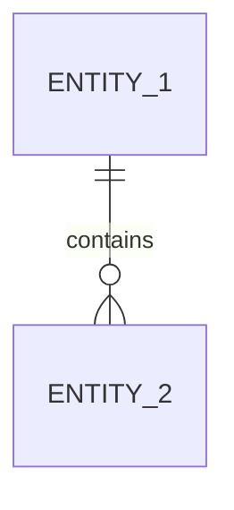

# Модель данных

> Логическая модель доменных сущностей и физическая модель хранения/конфигурации (схемы JSON/Zod, локальное хранилище или таблицы СУБД).

---

## 1. Логическая модель сущностей

### [Сущность 1]

| Поле | Тип | Описание |
|------|-----|----------|
| `id` | `string` / `number` | Уникальный идентификатор |
| `[field]` | `[type]` | `[описание]` |

---

## 2. ER-диаграмма связей

---

## 3. Физическая модель и валидация схем

| Правило | Значение |
|---------|---------|
| Идентификаторы | Стабильные строковые ID / UUID |
| Валидация на границах | Строгая валидация схем при чтении/записи (`Zod` / `Pydantic` / JSON Schema / ограничения БД) |
| Хранилище | `[Указать выбранное хранилище и причину выбора]` |
