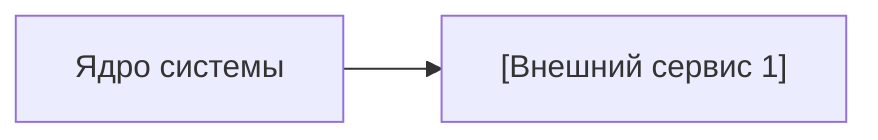

# Внешние интеграции

> Внешние сервисы, SDK и API, с которыми взаимодействует система.

---

## 1. Реестр интеграций

| Сервис / SDK | Назначение | Направление | Протокол / Пакет | Критичность |
|--------------|------------|-------------|------------------|-------------|
| **[Сервис 1]** | `[Для чего используется]` | `In / Out` | `HTTPS REST / SDK` | `MVP / Опционально` |

---

## 2. Диаграмма интеграций

---

## 3. Зависимости, лимиты и fallback-поведение

| Интеграция | Риск (недоступность / лимиты) | Митигация / Fallback |
|-----------|-------------------------------|----------------------|
| **[Сервис 1]** | `[Риск]` | `[Как система ведёт себя при сбое]` |
