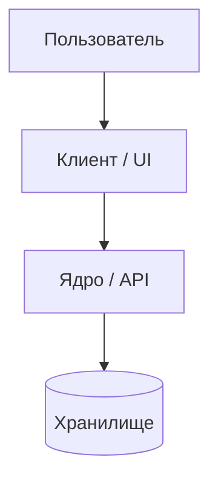

# Техническое видение проекта

> **Шаблон:** заполни все разделы. Удали инструкции в `[]` после заполнения.

---

## 1. Система в целом

[2–3 предложения: что это за система, как она называется, в чём её ядро.]

---

## 2. Роли

| Роль | Описание |
|------|----------|
| **[Роль 1]** | [Что делает в системе] |
| **[Роль 2]** | [Что делает в системе] |

---

## 3. Пользовательские сценарии

### [Роль 1]
- **С-1: [Название]** — [что пользователь делает / видит]
- **С-2: [Название]** — [что пользователь делает / видит]

---

## 4. Архитектура (high-level)

> Детали — в [`architecture.md`](architecture.md).



---

## 5. Компоненты системы

- **[Компонент 1]:** [Что делает и чего НЕ делает]
- **[Компонент 2]:** [Что делает]

---

## 6. Структура проекта

```
project/
├── src/
├── tests/
├── l1dder/
└── docs/
    ├── concept/
    ├── adrs/
    ├── ideas.md
    ├── backlog.md
    ├── roadmap.md
    ├── specs/
    └── sprints/
```

---

## 7. Доменные сущности

| Сущность | Смысл |
|----------|-------|
| **[Сущность 1]** | [Что это в доменном смысле] |

---

## 8. Принципы разработки и Технологии

- **Ponytail & Deep Modules:** минимум кода, глубокие модули с чистыми публичными швами (`Seams`).
- **KISS & YAGNI:** реализуем только то, что нужно для текущей задачи из Роадмапа.

| Область | Решение |
|---------|---------|
| Язык и рантайм | [Технология + версия] |
| Фреймворк / UI | [Технология + версия] |
| Данные / Схемы | [Технология + версия] |
| Тесты и качество | [Технология + версия] |
