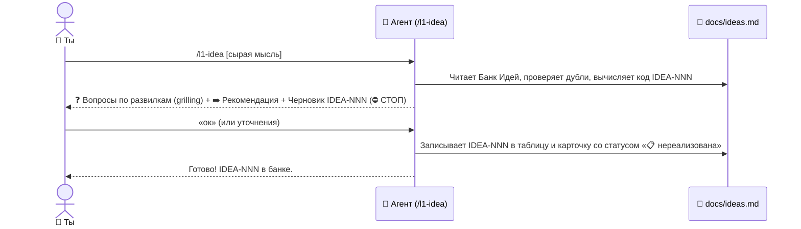
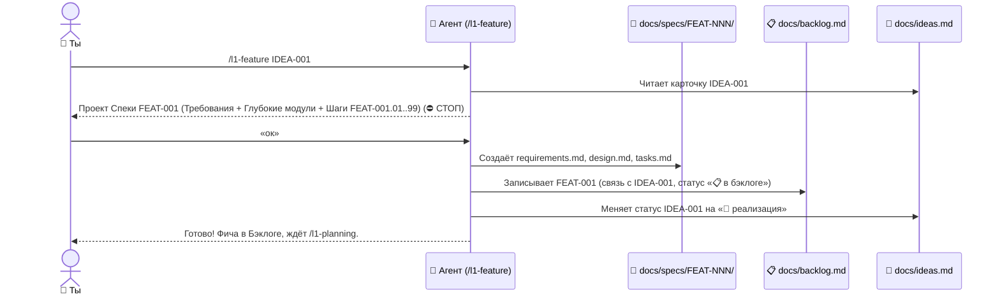
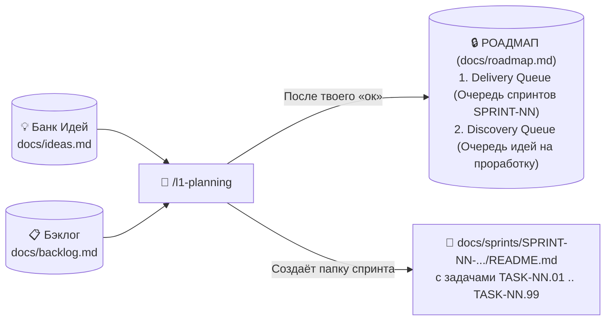
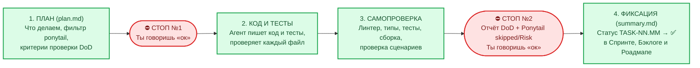
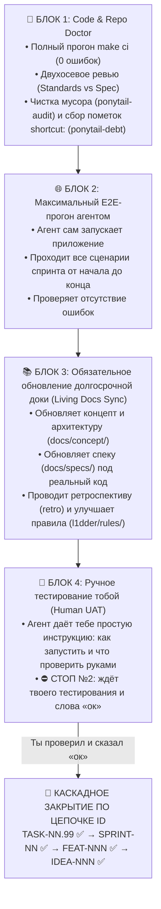
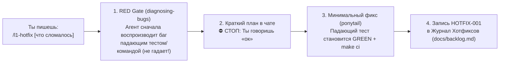

# 🔍 2. Подробный разбор всех цепочек `L1DDER`

> ⬅️ Назад к [Быстрому старту (01-QUICKSTART.md)](./01-QUICKSTART.md) | ➡️ Далее к [Шпаргалке на 1 экран (03-CHEATSHEET.md)](./03-CHEATSHEET.md)

В этом документе разобрана каждая управляющая кнопка (`/l1-onboard`, `/l1-idea`, `/l1-feature`, `/l1-planning`, `/l1-task`, `/l1-hotfix`): зачем она нужна, какая магия работает внутри неё под капотом и где агент ждёт твоего решения.

---

## 🧭 Кнопка 0: `/l1-onboard` — Старт проекта и настройка стека

**Когда нажимать:** Один раз сразу после `npx l1dder init` (как в новом пустом проекте, так и в существующем репозитории с кодом).
- Агент определяет режим (`from-scratch` или `existing-code`), настраивает файл стека `l1dder/rules/30-tech-stack.mdc` и `Makefile`, синхронизирует правила агентов и пошагово создаёт `docs/concept/`, `docs/ideas.md`, `docs/backlog.md` и `docs/roadmap.md`.

---

## 💡 Кнопка 1: `/l1-idea` — Рождение и развитие идеи

**Когда нажимать:** В любой момент, когда тебе в голову пришла задумка (новая фича, улучшение, механика). Даже если сейчас идёт спринт по совсем другой теме — смело вызывай `/l1-idea`: она просто положит мысль в Банк Идей, не ломая текущую работу.

**Что работает под капотом:**
- **`grilling` (умное интервью):** Агент не мучает тебя десятком пустых вопросов. Он задаёт только реальные продуктовые развилки в формате `❓ Q1 ... ➡️ Рекомендация`. Если тебе нравится его рекомендация — ты просто пишешь одно слово `ок`.
- **`ponytail` (отсечение лишнего):** Агент сразу предлагает самый простой вариант без переусложнения и записывает, что мы намеренно НЕ делаем на первом этапе.

---

## 📐 Кнопка 2: `/l1-feature` — Проработка ТЗ (Спеки) и Бэклога

**Когда нажимать:** Когда ты хочешь взять идею `IDEA-NNN` из Банка Идей и превратить её в чёткое техническое задание (спецификацию) и список задач в Бэклоге.

**Что создаётся в итоге:**
1. Папка `docs/specs/FEAT-NNN-<название>/` с тремя файлами:
   - `requirements.md` — что именно видит и делает пользователь.
   - `design.md` — какие глубокие модули (`codebase-design`) создаются и какие публичные точки (`Seams`) будут покрыты автотестами.
   - `tasks.md` — нарезка на шаги `FEAT-NNN.01`, `FEAT-NNN.02`, ..., и **обязательный финальный шаг `FEAT-NNN.99` (Doctor Checklist)**.
2. Запись в `docs/backlog.md` со статусом `📋 в бэклоге`.

---

## 🔒 Кнопка 3: `/l1-planning` — Планирование Роадмапа (Источника истины)

**Когда нажимать:**
- Когда в Бэклоге появилась новая фича и нужно поставить её в очередь на разработку;
- Когда ты передумал и хочешь поменять порядок спринтов или приоритеты;
- Когда закончился текущий спринт и пора наметить следующие шаги.

**Почему Роадмап так важен:**
В `L1DDER` действует железное правило **Roadmap Gate**: агент имеет право писать код (`20-workflow.mdc`) **только по тому спринту, который стоит на строчке `1 (CURRENT)` в `docs/roadmap.md`**. Это защищает проект от хаоса, когда посреди одной недоделанной фичи начинают пилить три другие.

---

## ⚙️ Кнопка 4: `/l1-task` — Пошаговая разработка и Финальный Доктор спринта

**Когда нажимать:** Каждый раз, когда нужно делать следующую задачу по плану. Ты просто вводишь `/l1-task` без лишних объяснений — агент сам находит текущую задачу в Роадмапе.

### Часть А: Как проходит обычная задача (`TASK-NN.01`, `TASK-NN.02`...) — Правило двух СТОПов

Ни одна строчка кода не пишется и ни одна задача не закрывается без твоего согласия:

---

### Часть Б: 🩺 Обязательный финал каждого спринта — `TASK-NN.99` (`Doctor Checklist`)

В `L1DDER` **ни один спринт не может завершиться просто так**. Последней задачей каждого спринта всегда стоит специальная гигиеническая задача **`TASK-NN.99` (`Doctor Checklist`)**.

Когда обычные задачи спринта закончились и ты вызываешь `/l1-task`, агент превращается в строгого ревизора и проходит **4 обязательных блока**:

Если во время ручного теста в Блоке 4 тебе что-то не понравилось — ты просто пишешь это в чат, агент тут же правит это внутри `TASK-NN.99`, заново проверяет и показывает тебе!

---

## 🚑 Кнопка 5: `/l1-hotfix` — Экстренная починка бага в обход Роадмапа

**Когда нажимать:** Когда что-то сломалось и это нужно починить прямо сейчас, не разводя бюрократию со спеками и спринтами.

---

👉 **Дальше:** открой **[03-CHEATSHEET.md](./03-CHEATSHEET.md)** — там шпаргалка на 1 экран для ежедневной работы!
