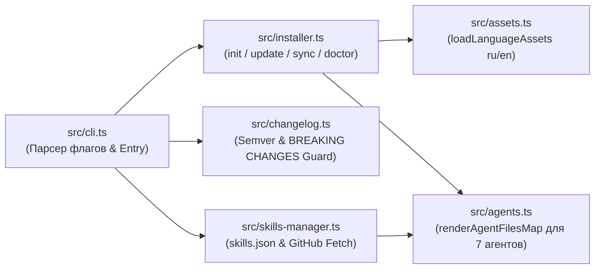

# Архитектура системы L1DDER

> Продуктовое видение — в [vision.md](vision.md). Модель данных и манифестов — в [data-model.md](data-model.md).

---

## 1. Контекст и диаграмма модулей

---

## 2. Глубокие модули и публичные швы (`Deep Modules & Seams`)

| Модуль | Публичный интерфейс (`Seam`) | Что скрыто внутри (`Depth`) |
|--------|------------------------------|-----------------------------|
| `src/assets.ts` | `loadLanguageAssets(lang, rootDir)` | Рекурсивное чтение `assets/i18n/{ru,en}/`, подстановка кастомного `rootDir` и разметка защищённых файлов стека (`STACK_PROTECTED_FILES`). |
| `src/agents.ts` | `renderAgentFilesMap(options)`, `syncAgentIntegrations(options)`, `parseFrontmatter(md)` | Парсинг однострочного и многострочного YAML frontmatter, маркерное слияние (`<!-- l1dder:begin -->`), генерация форматов для `Cursor`, `Claude Code`, `Codex`, `Windsurf`, `Copilot`, `OpenCode`, `Cline` и фильтрация `scope: "all" | "skills-only"`. |
| `src/skills-manager.ts` | `readSkillsManifest()`, `addStackSkillToManifest()`, `installSkillsFromManifest()` | Работа с `l1dder/skills.json`, резолвинг URL-путей в GitHub-репозиториях скиллов и синхронизация скачанных скиллов во все агенты. |
| `src/changelog.ts` | `getPendingReleases()`, `collectBreakingChanges()`, `formatUpdateChangelogReport()` | Сравнение версий `semver`, выборка промежуточных релизов из `assets/releases.json` и формирование предупреждений о `BREAKING CHANGES`. |
| `src/installer.ts` | `runProjectSync()`, `runProjectDoctor()` | Идемпотентная установка и обновление (полное или `skillsOnly`), умный мерж `l1dder/skills.json` с сохранением массива `stack` и диагностика `doctor`. |

---

## 3. Локальная разработка и проверка

- Полный цикл проверки: `make ci` (`npm run typecheck && npm run build && npm test && npm run docs:build && node dist/cli.js doctor`).
