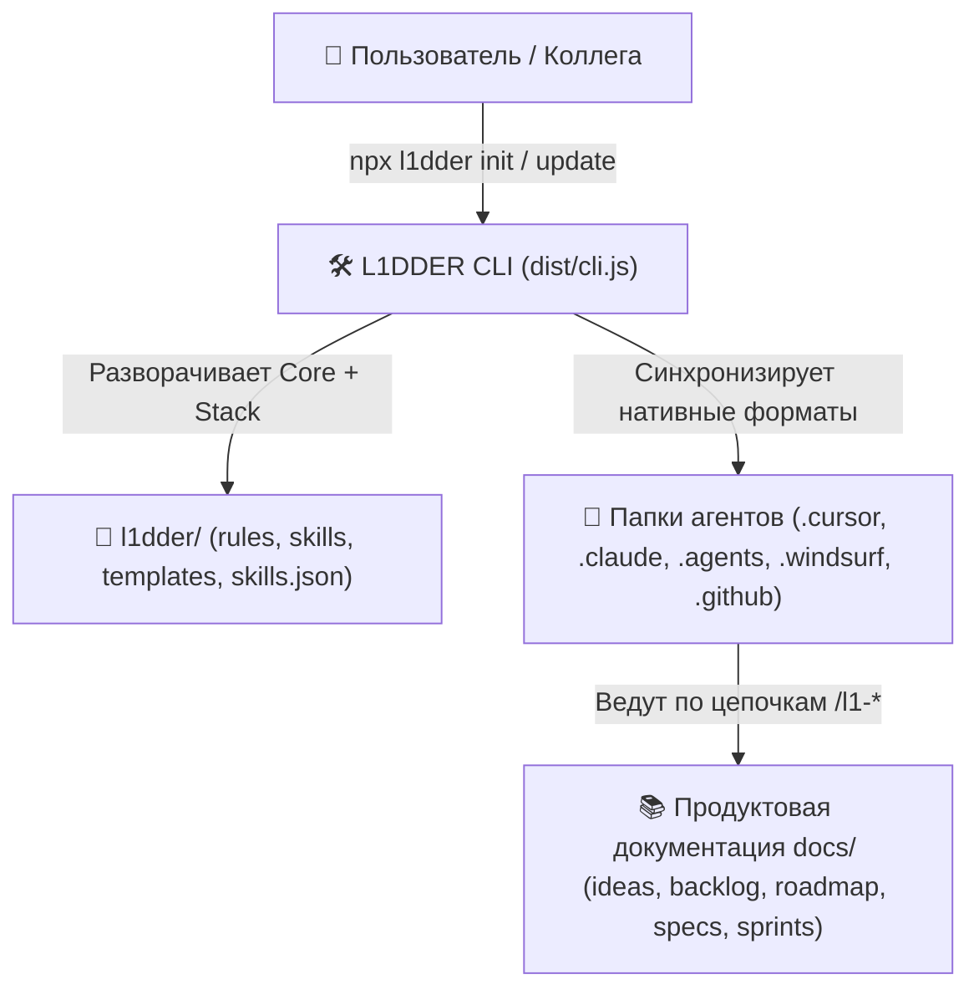

# Техническое видение проекта L1DDER

---

## 1. Система в целом

`L1DDER` представляет собой npm-пакет (`l1dder`), объединяющий:
1. **Эталонный двуязычный каталог методологии (`assets/i18n/{ru,en}/`)** — правила, 20 скиллов, шаблоны с `ID Passport` и пользовательский путеводитель.
2. **Тонкий CLI-инсталлятор и менеджер обновлений (`src/` → `dist/cli.js`)** — разворачивает папку `l1dder/`, генерирует нативные конфигурации для 7 ИИ-агентов, управляет манифестом `l1dder/skills.json` и проверяет `BREAKING CHANGES` по `assets/releases.json`.
3. **Двуязычный сайт документации (`site/`)** на базе VitePress + Mermaid.

---

## 2. Роли

| Роль | Описание |
|------|----------|
| **Пользователь (Человек)** | Устанавливает/обновляет `l1dder` (через терминал или чат агента), управляет продуктом командами `/l1-*` и принимает работу на точках `⛔ СТОП`. |
| **ИИ-Агент (Cursor / Claude / Codex и др.)** | Читает правила и скиллы из `l1dder/`, ведёт диалог по `grilling`, пишет минимальный код по `ponytail` и синхронизирует статусы по цепочке ID. |
| **Мейнтейнер фреймворка** | Развивает сам `L1DDER` по принципу 100% догфудинга, тестирует скиллы на полигоне `playground/` на разных моделях и выпускает релизы в npm. |

---

## 3. Архитектура (High-Level)

---

## 4. Принципы разработки и Технологии

- **Zero Hidden State:** никакого `state.yml` — состояние проекта полностью определяется файлами в `docs/`.
- **Core vs Stack Separation:** обновление ядра (`npx l1dder@latest update`) никогда не затирает проектный стек (`30-tech-stack.mdc` и секцию `"stack"` в `l1dder/skills.json`).
- **Zero Runtime Bloat (`ponytail`):** бандл `dist/cli.js` использует только встроенные модули `Node.js` (`node:fs`, `node:path`, `node:readline/promises`) и весит ~65 КБ.

| Область | Решение |
|---------|---------|
| Язык и рантайм | `TypeScript 5.7+` (`strict: true`), `Node.js >= 20` |
| Сборщик CLI | `tsup` (ESM bundle) |
| Тесты и полигон | `Vitest` + `playground/` (мульти-модельный прогон на `Composer` и `Grok`) |
| Документация | `VitePress 1.6+` + `vitepress-plugin-mermaid` (GitHub Pages) |
| Публикация | GitHub Actions + npm OIDC Trusted Publishing (`publish.yml`) |
