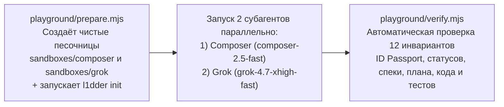

# FEAT-002: Предрелизный гигиенический спринт, полигон на 2 моделях (Composer и Grok), аудит ponytail и релиз v1.0.0 — Технический дизайн (Design)

| Поле паспорта | Значение |
|---------------|----------|
| **ID фичи / спеки** | `FEAT-002` |
| **Родительская идея (`IDEA-NNN`)** | [`IDEA-002`](../../ideas.md#idea-002) |
| **Требования** | [`requirements.md`](./requirements.md) |
| **Декомпозиция шагов** | [`tasks.md`](./tasks.md) |

---

## 1. Архитектурное решение полигона `playground/`

Полигон `playground/` изолируется от основного репозитория (папка `playground/sandboxes/` добавляется в `.gitignore`) и состоит из двух детерминированных скриптов:

---

## 2. Затрагиваемые глубокие модули и публичные швы (`codebase-design` & `tdd`)

| Модуль (`Module`) | Публичный интерфейс (`Interface` на шве `Seam`) | Что скрыто внутри (`Depth`) | Как тестируем (`Pre-agreed Test Seam`) |
|-------------------|-------------------------------------------------|-----------------------------|----------------------------------------|
| `playground/prepare.mjs` | `prepareSandbox(name, lang)` | Очистка `playground/sandboxes/<name>`, создание мини-проекта (`package.json`, `src/math.js`), запуск `dist/cli.js init --yes` | Запуск `node playground/prepare.mjs` создаёт готовые песочницы с `l1dder/` |
| `playground/verify.mjs` | `verifySandbox(sandboxPath)` | 12 строгих проверок: `docs/ideas.md` (`IDEA-001`), `docs/specs/FEAT-001-*/{requirements,design,tasks}.md` (с `FEAT-001.99`), `docs/backlog.md`, `docs/roadmap.md` (`SPRINT-01`), `docs/sprints/SPRINT-01-*/README.md`, `plan.md`, `summary.md` (с полными `ID Passport`) и прохождение тестов мини-проекта | `node playground/verify.mjs` возвращает код `0` только при 100% соблюдении стандарта `L1DDER` обеими моделями |
| `src/*` (CLI `l1dder`) | `runCli()`, `runProjectSync()`, `checkAndConfirmBreakingUpdate()` | Логика установки, обновления, манифеста скиллов и чейнджлога | `vitest run` (`tests/cli.test.ts`) + ревизия `ponytail-audit` |
