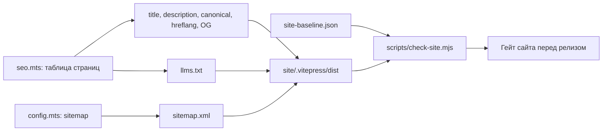

# FEAT-003: SEO-база сайта и витрин проекта — Технический дизайн (Design)

| Поле паспорта | Значение |
|---------------|----------|
| **ID фичи / спеки** | `FEAT-003` |
| **Родительская идея (`IDEA-NNN`)** | [`IDEA-003`](../../ideas.md#idea-003) |
| **Требования** | [`requirements.md`](./requirements.md) |
| **Декомпозиция шагов** | [`tasks.md`](./tasks.md) |

## 1. Архитектурное решение

Все SEO-данные страниц хранятся в одной таблице модуля `site/.vitepress/seo.mts`. Из неё VitePress получает теги страниц, а при сборке появляется `llms.txt`. `sitemap.xml` строит сам VitePress. Готовую сборку проверяет `scripts/check-site.mjs`, а сравнение со снимком исключает регрессии.



Данные не кладутся во frontmatter страниц: часть страниц `site/` перезаписывается из `assets/i18n/` скриптом `scripts/sync-site-docs.mjs`, и служебные поля попали бы в `l1dder/user-guide/` у пользователей.

## 2. Затрагиваемые глубокие модули и публичные швы (`codebase-design` & `tdd`)

| Модуль (`Module`) | Публичный интерфейс (`Interface` на шве `Seam`) | Что скрыто внутри (`Depth`) | Как тестируем (`Pre-agreed Test Seam`) |
|-------------------|-------------------------------------------------|-----------------------------|----------------------------------------|
| `site/.vitepress/seo.mts` | `buildPageSeo(relativePath)` | Таблица страниц, сборка адресов с базовым путём, языковые пары, теги OG и Twitter | Конкретные примеры для `index.md` и `en/guide.md`: адрес, `hreflang`, заголовок |
| `site/.vitepress/seo.mts` | Таблица страниц против файлов `site/` | Полнота и уникальность | Страница без записи или повтор заголовка и описания роняет тест |
| `site/.vitepress/seo.mts` | `renderLlmsTxt()` | Формат `llms.txt` | Есть название, описание и все 18 страниц с адресами |
| `scripts/check-site.mjs` | `node scripts/check-site.mjs` в `make test-e2e`, с `--baseline` в `make site-gate` | Разбор готовой сборки и сравнение со снимком | Запуск на маленьких примерах сборки: битая ссылка, потерянный H1 и лишний адрес в sitemap дают ненулевой код выхода |

Проверку на удаление проходят оба модуля. Без `seo.mts` логика разойдётся по 18 страницам и конфигу, а без `check-site.mjs` гейт останется ручным и его легко пропустить.

## 3. Модель данных / Схема конфига / Контракты

```ts
interface PageSeo {
  title: string;       // полный заголовок без шаблона "| L1DDER"
  description: string; // уникальное описание страницы
}
// Ключ таблицы: относительный путь страницы, например "en/guide.md"

interface SiteBaselinePage {
  path: string;         // адрес страницы
  h1: string;
  textLength: number;   // длина основного текста
  mermaidCount: number;
  navLinks: string[];   // ссылки меню и боковой панели
}
```

`docs/sprints/SPRINT-02-seo-foundation/site-baseline.json` делается один раз до первых правок: с живого сайта и из сборки текущего кода. Позже он обновляется только осознанно, вместе с причиной.

## 4. Принятые решения и риски

| Вопрос / Развилка | Выбранное решение | Почему (обоснование) |
|-------------------|-------------------|----------------------|
| Как доставить результат | В конце спринта релиз `v1.0.3` после отдельного подтверждения | Сайт деплоится только из `main`, описание в npm обновляется только с новой версией |
| Свой домен | Пока `ledvanoff.github.io/l1dder/`, адрес задан в одном месте | Домен решается отдельно, перенаправления проектного сайта не подтверждены |
| Картинка превью | Одна статичная карточка 1200×630 | Хватает для первого шага, персональные карточки не окупаются |
| `llms.txt` | Файл в `/l1dder/llms.txt`, собирается из той же таблицы | Требование пользователя. Расположение в подпапке связано с хостингом: корень домена не наш. Использование файла поисковиками не гарантировано |
| Защита сайта | Снимок до правок + автоматическая проверка сборки + ручной браузерный гейт | Автопроверка не видит поломок в браузере, ручная проверка легко теряет ссылки и файлы |
| Где сравнивать со снимком | Отдельная цель `make site-gate`, а `make ci` проверяет только ссылки, якоря и файлы | Постоянное сравнение со снимком мешало бы будущим правкам документации, например сокращению текста |
| Где теги подтверждения | На корневой странице `ledvanoff.github.io`, а не в `buildPageSeo` | Яндекс Вебмастер подтверждает весь адрес `https://ledvanoff.github.io`, а не путь `/l1dder/`. Корень также даёт `robots.txt` и `llms.txt` на привычных адресах |
| Сбой гейта | Релиз не запускается, причина чинится внутри спринта | Требование пользователя: не сломать сайт |
| Сбой после деплоя | Откат согласуется с пользователем (`git revert` в `main` и повторный деплой) | Пуш в `main` и повторный запуск деплоя затрагивают опубликованный сайт |
