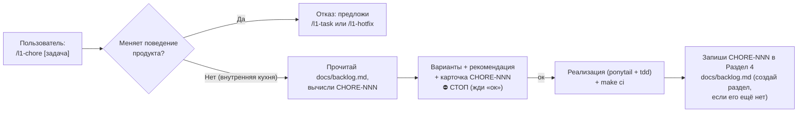

# FEAT-005: Команда `/l1-chore` для служебных правок вне роадмапа — Технический дизайн (Design)

| Поле паспорта | Значение |
|---------------|----------|
| **ID фичи / спеки** | `FEAT-005` |
| **Родительская идея (`IDEA-NNN`)** | [`IDEA-004`](../../ideas.md#idea-004) |
| **Требования** | [`requirements.md`](./requirements.md) |
| **Декомпозиция шагов** | [`tasks.md`](./tasks.md) |

## 1. Архитектурное решение

Фича добавляет 8-й управляющий скилл `l1-chore` в `assets/i18n/{ru,en}/skills/l1-chore/SKILL.md` и регистрирует его в манифесте `skills.json` и CLI (`src/agents.ts`, `src/installer.ts`).

Поток выполнения `/l1-chore` строится по образцу `/l1-hotfix` (одна остановка `⛔ СТОП` в чате без создания `plan.md` и `summary.md`):



Внутренний раздел 6 файла `l1dder/rules/30-tech-stack.mdc` (и правило 8 в `AGENTS.md`) упрощается: общий порядок выполнения теперь живёт в `/l1-chore`, а в `30-tech-stack.mdc` и `AGENTS.md` остаются только специфичные для самого репозитория `L1DDER` инварианты (не трогать `src/` и `assets/`, не поднимать версию в `assets/releases.json`, коммитить в `dev`).

## 2. Затрагиваемые глубокие модули и публичные швы (`codebase-design` & `tdd`)

| Модуль (`Module`) | Публичный интерфейс (`Interface` на шве `Seam`) | Что скрыто внутри (`Depth`) | Как тестируем (`Pre-agreed Test Seam`) |
|-------------------|-------------------------------------------------|-----------------------------|----------------------------------------|
| `assets/i18n/{ru,en}/skills/l1-chore/SKILL.md` | Пошаговый текст скилла `/l1-chore` | Проверка границы «продукт vs внутренняя кухня», расчёт `CHORE-NNN`, шаблон карточки с `⛔ СТОП`, автосоздание раздела 4 в `docs/backlog.md` | `tests/chore-skill.test.ts` — контракт текста на RU и EN |
| `src/agents.ts` & `src/installer.ts` | `renderAgentFilesMap()`, `buildEntryPointSummary()`, `runProjectDoctor()` | Включение `l1-chore` в `USER_INVOKED_COMMAND_SKILLS`, сводку `AGENTS.md` / `CLAUDE.md` и список обязательных файлов `doctor` (21 скилл) | `tests/cli.test.ts` — проверка 21 скилла, генерации файлов для всех агентов и `doctor` |
| `assets/i18n/{ru,en}/templates/backlog/backlog-template.md` + `rules/{00,20,40}-*.mdc` + `GLOSSARY.md` | Шаблон бэклога, таблицы ID и правил `Roadmap Gate` | 4-колоночная таблица `CHORE-NNN`, второе исключение из `Roadmap Gate` и определение термина в словаре | `tests/chore-skill.test.ts` — проверка наличия `CHORE-NNN` и `/l1-chore` в шаблоне, правилах и словаре на RU и EN |
| `src/changelog.ts` & `src/cli.ts` + `scripts/sync-release-meta.mjs` | `npx l1dder update`, поле `agent` в `assets/releases.json` | Сбор шагов пропущенных версий по порядку, блок 🤖 после обновления, отказ сборки без `agent` у новой версии | `tests/cli.test.ts` + `tests/sync-release-meta.test.ts` (`Seam 4`) |

**Согласованные публичные швы (`Pre-agreed Test Seams`):**

- `Seam 1` (`tests/chore-skill.test.ts` — контракт скилла `/l1-chore` на RU и EN):
  - проверяет наличие проверки границы (отказ и предложение `/l1-task` или `/l1-hotfix`, если меняется поведение продукта);
  - проверяет наличие ровно одной остановки `⛔ СТОП` / `⛔ STOP`, требования `make ci` и инструкции добавить раздел 4 в `docs/backlog.md`, если его нет;
  - проверяет совпадение числа шагов и остановок между RU и EN.
- `Seam 2` (`tests/cli.test.ts` — интеграция в CLI и агенты):
  - `listDeclaredSkills()` возвращает **21** установленный скилл;
  - `renderAgentFilesMap()` создаёт `.agents/skills/l1-chore/SKILL.md`, `.claude/skills/l1-chore/SKILL.md`, `.windsurf/workflows/l1-chore.md`, `.github/prompts/l1-chore.prompt.md`;
  - `buildEntryPointSummary()` на RU и EN включает `/l1-chore` и называет его в правиле `Roadmap Gate`.
- `Seam 4` (`tests/cli.test.ts` и `tests/sync-release-meta.test.ts` — инструкция агенту после `update`):
  - `runCli update` с подставленным каталогом релизов печатает после обновления блок 🤖 с шагами пропущенных версий по порядку; для `agent: []` — «ручных шагов нет»; без смены версии блока нет;
  - `scripts/sync-release-meta.mjs` падает, если у верхней версии (новее `1.1.0`) нет `agent` или RU и EN расходятся по числу шагов.
- `Seam 3` (`tests/chore-skill.test.ts` — шаблон бэклога, правила и словарь):
  - `backlog-template.md`, `00-methodology.mdc`, `20-workflow.mdc`, `40-skills-router.mdc` и `GLOSSARY.md` на RU и EN содержат `CHORE-NNN` и `/l1-chore`.

## 3. Модель данных / Схема конфига / Контракты

Формат таблицы раздела 4 в `docs/backlog.md` и `assets/i18n/{ru,en}/templates/backlog/backlog-template.md` (4 колонки):

- **RU:**
  ```markdown
  ## 4. Журнал служебных правок (`CHORE-NNN`)

  > Служебные правки внутренней кухни проекта без изменения поведения продукта, выполненные через `/l1-chore`.

  | ID правки | Дата | Что и зачем | Сообщение коммита |
  |:---------:|------|-------------|:-----------------:|
  | `CHORE-001` | 2026-10-21 | [Что и зачем изменили] | `chore(ci): ...` |
  ```
- **EN:**
  ```markdown
  ## 4. Chore Log (`CHORE-NNN`)

  > Internal repository maintenance changes that do not alter product behavior, executed via `/l1-chore`.

  | Chore ID | Date | What and why | Commit message |
  |:--------:|------|--------------|:--------------:|
  | `CHORE-001` | 2026-10-21 | [What changed and why] | `chore(ci): ...` |
  ```

### Инструкция агенту в `assets/releases.json` (`FEAT-005.04`)

Необязательное для версий до `1.1.0` и обязательное для новых поле записи релиза:

```json
"agent": {
  "ru": ["Шаг 1 ...", "Шаг 2 ..."],
  "en": ["Step 1 ...", "Step 2 ..."]
}
```

В `CHANGELOG.md` и заметки к релизу на GitHub поле не попадает: оно нужно только агенту.

**Текст шагов для ближайшего релиза с `/l1-chore`** (вписать в `agent` при выпуске):

- **RU:** «В `l1dder/rules/40-skills-router.mdc`, в таблице раздела 0, после строки `/l1-hotfix` добавь строку: `| Поправить сам проект, а не продукт: правила git, CI, библиотеки, `Makefile`, тесты, правила агента — с одной остановкой «ок» и записью `CHORE-NNN` в `docs/backlog.md` | `/l1-chore` | `l1dder/skills/l1-chore/SKILL.md` |` Остальное в файле не меняй.»
- **EN:** «In `l1dder/rules/40-skills-router.mdc`, in the section 0 table, add this row after the `/l1-hotfix` row: `| Change the project itself, not the product: git rules, CI, libraries, `Makefile`, tests, agent rules — with a single "ok" stop and a `CHORE-NNN` row in `docs/backlog.md` | `/l1-chore` | `l1dder/skills/l1-chore/SKILL.md` |` Leave the rest of the file unchanged.»

## 4. Принятые решения и риски

| Вопрос / Развилка | Выбранное решение | Почему (обоснование) |
|-------------------|-------------------|----------------------|
| Колонки таблицы `CHORE-NNN` | 4 колонки (`ID правки \| Дата \| Что и зачем \| Сообщение коммита`) | Служебная правка не привязана к фиче и записывается по факту выполнения; 100% совместимость с уже ведущимся журналом в `docs/backlog.md` |
| Триггер вызова скилла | Слэш-команда `/l1-chore` + словесный запрос про служебную/`chore`-правку в чате | Удобно и через меню команд, и обычным текстом |
| Старые проекты без раздела 4 в `docs/backlog.md` | Скилл `/l1-chore` сам дописывает раздел 4 в конец `docs/backlog.md` | `npx l1dder update` не перезаписывает пользовательский `docs/` |
| Как старые проекты получают правки защищённых файлов (`40-skills-router.mdc`) | Обязательная инструкция агенту для каждой версии (`agent` в `assets/releases.json`), которую `update` всегда печатает | Слияние файла в коде перезаписало бы ручные правки пользователя в разделах 0–1; агент добавляет только нужную строку |
| Снимок сайта `docs/site-baseline.json` | Проверить через `make site-gate` (обновить `make site-baseline` только если изменится проверяемая структура) | Добавление текста на существующие страницы не ухудшает базовый снимок |
