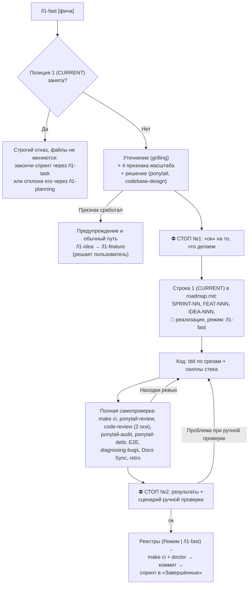

# FEAT-006: Режим `/l1-fast` и отклонение текущего спринта — Технический дизайн (Design)

| Поле паспорта | Значение |
|---------------|----------|
| **ID фичи / спеки** | `FEAT-006` |
| **Родительская идея (`IDEA-NNN`)** | [`IDEA-005`](../../ideas.md#idea-005) |
| **Требования** | [`requirements.md`](./requirements.md) |
| **Декомпозиция шагов** | [`tasks.md`](./tasks.md) |
| **Арх. решение** | [`ADR-0002`](../../adrs/ADR-0002-sprint-rejection-rollback.md) |

## 1. Архитектурное решение

Фича добавляет 9-й управляющий скилл `l1-fast` в `assets/i18n/{ru,en}/skills/l1-fast/SKILL.md`, регистрирует его в манифесте `skills.json` и CLI (`src/agents.ts`, `src/installer.ts`) по образцу `/l1-chore`, и добавляет в `/l1-planning` ветку «Отклонить текущий спринт». Нового кода в CLI нет, только регистрация.

### Почему ровно две обязательные остановки

Остановка нужна только там, где решить может один человек: **что строим** (`⛔ СТОП №1`) и **принимаю ли результат** (`⛔ СТОП №2`, ручная проверка). Убрать любую из двух нельзя: без первой агент может сделать не ту фичу, без второй нет приёмки. Всё остальное — механика, которую агент делает сам. В обычном пути у задачи и `TASK-NN.99` четыре остановки; скорость `/l1-fast` даёт автономная работа между двумя, а не пропуск проверок.



Остановки по условию: признак масштаба (до `⛔ СТОП №1`), рост объёма или вопрос ревью, который решает только человек. После находки при ручной проверке агент прогоняет **весь** список проверок заново.

### Отклонение текущего спринта (`/l1-planning`)


## 2. Затрагиваемые глубокие модули и публичные швы (`codebase-design` & `tdd`)

| Модуль (`Module`) | Публичный интерфейс (`Interface` на шве `Seam`) | Что скрыто внутри (`Depth`) | Как тестируем (`Pre-agreed Test Seam`) |
|-------------------|-------------------------------------------------|-----------------------------|----------------------------------------|
| `assets/i18n/{ru,en}/skills/l1-fast/SKILL.md` | Одна команда `/l1-fast [фича]` | Проверка `CURRENT`, 4 признака масштаба, две остановки, обязательный список проверок и скиллов, бронь в роадмапе, порядок заполнения реестров, пометка режима | `tests/fast-skill.test.ts` (`Seam 1`) |
| `src/agents.ts` & `src/installer.ts` | `listDeclaredSkills()`, `renderAgentFilesMap()`, `buildEntryPointSummary()`, `runProjectDoctor()` | `l1-fast` в `USER_INVOKED_COMMAND_SKILLS`, в сводке `AGENTS.md` / `CLAUDE.md` и в списке обязательных файлов `doctor` | `tests/cli.test.ts` (`Seam 2`) |
| `assets/i18n/{ru,en}/rules/{00,20,40}-*.mdc`, `GLOSSARY.md`, `templates/roadmap/roadmap-template.md`, скиллы `l1-task` и `l1-hotfix` | Тексты `Roadmap Gate` и правила двух остановок | `/l1-fast` как исключение при пустой `CURRENT`, граница с `/l1-chore` и `/l1-hotfix` | `tests/fast-skill.test.ts` (`Seam 3`) |
| `assets/i18n/{ru,en}/skills/l1-planning/SKILL.md` + статусы в `20-workflow.mdc` и шаблонах | Ветка «Отклонить текущий спринт» | Показ коммитов, `⛔ СТОП`, `git revert`, статусы `❌ отклонена`, перенос в историю | `tests/planning-reject.test.ts` (`Seam 4`) |

Тест на удаление (`Deletion Test`): без скилла `/l1-fast` порядок «код раньше документов» и обязательный список проверок пришлось бы держать в голове человека и повторять в каждом чате — модуль глубокий. Отдельного модуля CLI для `/l1-fast` нет: за ним была бы одна реализация (выдуманный шов).

**Согласованные публичные швы (`Pre-agreed Test Seams`):**

- `Seam 1` (`tests/fast-skill.test.ts` — контракт скилла `/l1-fast` на RU и EN):
  - раздел «Для чего эта команда» идёт до шага 1;
  - шаг 1 при занятой `CURRENT` не меняет файлы и называет оба выхода: `/l1-task` и отклонение через `/l1-planning`;
  - перечислены все 4 признака масштаба и повторная оценка при росте объёма;
  - ровно две остановки `⛔ СТОП №1` и `⛔ СТОП №2` (`⛔ STOP #1`, `⛔ STOP #2`);
  - строка в роадмапе пишется после `⛔ СТОП №1` и до кода;
  - перед `⛔ СТОП №2` перечислены `make ci`, `ponytail-review`, `code-review`, `ponytail-audit`, `ponytail-debt`, `make test-e2e`, `diagnosing-bugs`, `retro`;
  - после находки при ручной проверке — весь список заново и снова `⛔ СТОП №2`;
  - названы все реестры (`ideas.md`, `backlog.md`, `roadmap.md`, `specs/`, `sprints/`) и пометка `режим: /l1-fast`;
  - RU и EN совпадают по числу шагов и остановок.
- `Seam 2` (`tests/cli.test.ts` — интеграция в CLI и агенты):
  - `listDeclaredSkills()` возвращает **22** скилла;
  - `renderAgentFilesMap()` создаёт `.agents/skills/l1-fast/SKILL.md`, `.claude/skills/l1-fast/SKILL.md`, `.windsurf/workflows/l1-fast.md`, `.github/prompts/l1-fast.prompt.md`;
  - `buildEntryPointSummary()` на RU и EN называет `/l1-fast` в правилах `Roadmap Gate` и двух остановок и в списке команд;
  - `doctor` падает без `skills/l1-fast/SKILL.md`.
- `Seam 3` (`tests/fast-skill.test.ts` — правила, словарь, шаблон, соседние скиллы):
  - `00-methodology.mdc`, `20-workflow.mdc`, `40-skills-router.mdc`, `GLOSSARY.md`, `roadmap-template.md`, `skills/l1-task/SKILL.md`, `skills/l1-hotfix/SKILL.md` на RU и EN содержат `/l1-fast`.
- `Seam 4` (`tests/planning-reject.test.ts` — отклонение спринта на RU и EN):
  - в `/l1-planning` есть ветка отклонения текущего спринта с `⛔ СТОП` до отката;
  - откат через `git revert`, текст запрещает `reset --hard`;
  - в `20-workflow.mdc` у `SPRINT-NN` и `TASK-NN.MM` есть статус `❌ отклонена`.

## 3. Модель данных / Схема конфига / Контракты

### Пометка режима в паспорте документов

```markdown
| **Режим** | `/l1-fast` |
```

В `plan.md`: `| **Режим** | `/l1-fast`, записан <дата> после реализации |`.

### Строка роадмапа после `⛔ СТОП №1`

```markdown
| **1 (CURRENT)** | `SPRINT-NN` | `FEAT-NNN` | `IDEA-NNN` | P2 | [Цель] (режим: `/l1-fast`) | 0/1 (+ TASK-NN.99) | 🚧 реализация | — *(после реализации)* |
```

И запись в «Историю изменений Роадмапа»: `SPRINT-NN` (`FEAT-NNN` ← `IDEA-NNN`) поставлен на `1 (CURRENT)` в режиме `/l1-fast`.

### Статусы

| Сущность | Было | Стало |
|----------|------|-------|
| `SPRINT-NN` | `📋 запланирована` → `🚧 реализация` → `✅ реализована` \| `⏸ пауза` | + `\| ❌ отклонена` |
| `TASK-NN.MM` | `📋 запланирована` → `🚧 реализация` → `✅ реализована` \| `⏸ пауза` | + `\| ❌ отклонена` |

### Инструкция агенту в `assets/releases.json` (вписать в `agent` при выпуске)

Все три шага касаются защищённого `l1dder/rules/40-skills-router.mdc`; остальное в файле не меняется.

- **RU:**
  1. «В `l1dder/rules/40-skills-router.mdc`, в таблице раздела 0, после строки `/l1-chore` добавь строку: `| Быстро сделать небольшую фичу продукта, когда нет активного спринта: две остановки «ок», полная проверка до приёмки, все документы с пометкой `режим: /l1-fast` после кода | `/l1-fast` | `l1dder/skills/l1-fast/SKILL.md` |`»
  2. «В том же файле в пункте 3 раздела «Как использовать» замени «в `/l1-task`, `/l1-hotfix` или `/l1-chore`» на «в `/l1-task`, `/l1-fast`, `/l1-hotfix` или `/l1-chore`».»
  3. «В том же файле в строке `/l1-planning` раздела 0 допиши в конец первой ячейки: «, или отклонить текущий спринт с откатом его изменений».»
- **EN:**
  1. "In `l1dder/rules/40-skills-router.mdc`, in the section 0 table, add this row after the `/l1-chore` row: `| Quickly build a small product feature when no sprint is active: two "ok" stops, full verification before acceptance, every document marked `mode: /l1-fast` after the code | `/l1-fast` | `l1dder/skills/l1-fast/SKILL.md` |`"
  2. "In the same file, in point 3 of "How to use", replace "in `/l1-task`, `/l1-hotfix` or `/l1-chore`" with "in `/l1-task`, `/l1-fast`, `/l1-hotfix` or `/l1-chore`"."
  3. "In the same file, in the `/l1-planning` row of section 0, append to the end of the first cell: ", or reject the current sprint and roll back its changes"."

Точные тексты строк сверяются с фактическими RU/EN-файлами `40-skills-router.mdc` в `FEAT-006.03`.

## 4. Принятые решения и риски

| Вопрос / Развилка | Выбранное решение | Почему (обоснование) |
|-------------------|-------------------|----------------------|
| Сколько остановок | Две обязательные (`⛔ СТОП №1` «что строим», `⛔ СТОП №2` приёмка) + остановки по условию | Остановка нужна только там, где решает один человек; меньше двух нельзя, больше — потеря скорости без выигрыша в качестве |
| Doctor Checklist | Весь список выполняется до `⛔ СТОП №2`, `TASK-NN.99` записывается закрытым вместе с остальными | Ни одна проверка не пропускается, лишних остановок нет |
| След в роадмапе во время работы | Строка `1 (CURRENT)` с забронированными ID сразу после `⛔ СТОП №1`, до кода | Держит `Roadmap Gate` и номера, прерванная сессия видит активный спринт |
| `plan.md` | Пишется после реализации с пометкой даты | Одинаковая структура папок задач, документ не выдаёт себя за написанный заранее |
| Пометка режима | Строка `Режим | /l1-fast` в паспорте, шаблоны не меняются | Меньше правок в ассетах, старые проекты не ломаются |
| Активный спринт при вызове `/l1-fast` | Строгий отказ: закончить через `/l1-task` или отклонить через `/l1-planning` | Нет параллельной работы и смешанных изменений |
| Где отклонение спринта | Ветка в `/l1-planning`, откат через `git revert` ([`ADR-0002`](../../adrs/ADR-0002-sprint-rejection-rollback.md)) | Изменения очереди живут в `/l1-planning`; отклонение нужно и без `/l1-fast`; история не переписывается |
| Обновление старых проектов | Шаги `agent` в `assets/releases.json` для `40-skills-router.mdc`, как у `/l1-chore` | Защищённый файл не перезаписывается, агент добавляет только нужные строки |
| Риск: автономный агент «срезает» проверки | Обязательный список в скилле + контрактный тест `Seam 1` + E2E-прогон в `FEAT-006.99` | Список проверяется и текстом, и живым прогоном |
| Снимок сайта `docs/site-baseline.json` | Проверить через `make site-gate`, обновлять `make site-baseline` только при изменении структуры | Добавление текста не ухудшает снимок |
