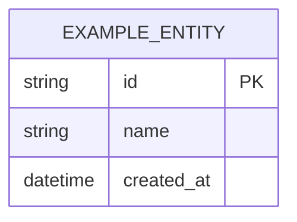

# Data Model — {{PROJECT_NAME}}

<!--
  Template: knowledge/{as-is,to-be}/erd.md
  Used by: l1dder init (scaffolding)
  Parsed by: extractSummary() — the ## Summary section
  Updated:
    to-be — after data schema decisions are made
    as-is — after delivery (implemented entities)
  Ownership: Architect

  Placeholder markers:
    {{PROJECT_NAME}} — the project name
    {{STATE}}        — "To-Be" or "As-Is"
    {{DATE}}         — the creation/update date
    {{AUTHOR}}       — the author (role or name)
    <!-- TODO: ... -- > — sections that need filling in

  Format: Mermaid erDiagram (logical level)
  The physical level (constraints, indexes, enums) — in code (ORM, migrations)
-->

> **State:** {{STATE}} | **Date:** {{DATE}} | **Author:** {{AUTHOR}}

## Summary

<!-- 10-20 lines: key entities and their relationships AS TEXT (not Mermaid!) -->
<!-- extractSummary() reads ONLY this section in SUMMARY mode -->
<!-- The Summary must be self-sufficient: the LLM understands the data model at 80% -->

<!-- TODO: List the main entities and their relationships -->
<!-- Recommended format: -->
<!-- The system manages N main entities: -->
<!-- - **Entity1** — description, relationship with Entity2 (1:N) -->
<!-- - **Entity2** — description, relationship with Entity3 (M:N) -->

## Details

### ERD Diagram

<!-- TODO: Mermaid erDiagram — the logical level only -->
<!-- Entities, (key) attributes, types, relationships -->

### Entity Descriptions

<!-- TODO: Details for each entity -->
<!-- Format: a table or sections per entity -->

| Entity | Purpose | Key attributes | Relationships |
|----------|------------|-------------------|-------|
| <!-- TODO --> | | | |
