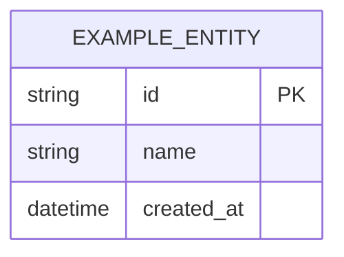

# Модель данных — {{PROJECT_NAME}}

<!--
  Шаблон: knowledge/{as-is,to-be}/erd.md
  Используется: l1dder init (scaffolding)
  Парсится: extractSummary() — секция ## Summary
  Обновляется:
    to-be — после принятия решений по схеме данных
    as-is — после delivery (реализованные сущности)
  Ownership: Architect

  Placeholder-маркеры:
    {{PROJECT_NAME}} — название проекта
    {{STATE}}        — "To-Be" или "As-Is"
    {{DATE}}         — дата создания/обновления
    {{AUTHOR}}       — автор (роль или имя)
    <!-- TODO: ... -- > — секции, требующие заполнения

  Формат: Mermaid erDiagram (логический уровень)
  Физический уровень (constraints, indexes, enums) — в коде (ORM, миграции)
-->

> **Состояние:** {{STATE}} | **Дата:** {{DATE}} | **Автор:** {{AUTHOR}}

## Summary

<!-- 10-20 строк: ключевые сущности и их связи ТЕКСТОМ (не Mermaid!) -->
<!-- extractSummary() читает ТОЛЬКО эту секцию в SUMMARY mode -->
<!-- Summary должен быть самодостаточным: LLM понимает модель данных на 80% -->

<!-- TODO: Перечислите основные сущности и их связи -->
<!-- Рекомендуемый формат: -->
<!-- Система управляет N основными сущностями: -->
<!-- - **Entity1** — описание, связь с Entity2 (1:N) -->
<!-- - **Entity2** — описание, связь с Entity3 (M:N) -->

## Details

### ERD-диаграмма

<!-- TODO: Mermaid erDiagram — только логический уровень -->
<!-- Сущности, атрибуты (ключевые), типы, связи -->

### Описание сущностей

<!-- TODO: Детализация по каждой сущности -->
<!-- Формат: таблица или секции по сущности -->

| Сущность | Назначение | Ключевые атрибуты | Связи |
|----------|------------|-------------------|-------|
| <!-- TODO --> | | | |
