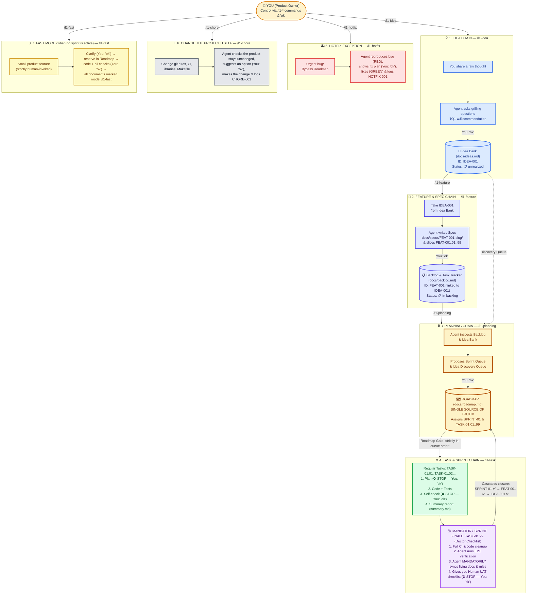
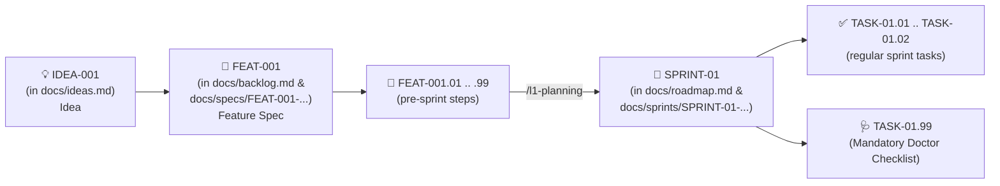

# 🚀 L1DDER — Human Guide (Vibe-Coder Friendly)

Welcome to **L1DDER**!
This guide is written in plain language. Even if you don't write code by hand and build products through chat with AI coding agents (**Cursor, Claude Code, Codex, Windsurf, Copilot, OpenCode, Cline**), in 3 minutes you'll see how to build complex, reliable software that doesn't fall apart on day three.

---

## Guide Navigation

| Document | What It Covers | Read Time |
|----------|----------------|:---------:|
| **[0. Main Map (You are here)](/en/guide)** | Core idea, **visual map of all flows**, nested ID chain, and the 3 control screens | 3 min |
| **[1. Quickstart & Live Walkthrough](/en/quickstart)** | One-command setup `npx l1dder init` + real chat walkthrough from idea to finished sprint | 5 min |
| **[2. Deep Dive into `/l1-*` Commands](/en/flows)** | Inside `/l1-onboard`, `/l1-idea`, `/l1-feature`, `/l1-planning`, `/l1-task` (`Doctor Checklist`), `/l1-hotfix`, `/l1-chore`, and `/l1-fast` | 7 min |
| **[3. One-Page Cheatsheet & FAQ](/en/cheatsheet)** | "What to press when..." table, all statuses, and FAQ | 2 min |

---

## Why `L1DDER`?

In ordinary vibe-coding, you ask *"Build me a dashboard"*, the AI writes 1,000 lines of code, and three days later adding a single button breaks half the app because the agent forgot yesterday's context.

In **L1DDER**, roles are strictly separated:
- 👤 **You are the Product Owner & Final Reviewer.** You bring ideas, set priorities, reply **"ok"** at decision checkpoints, and test the finished result.
- 🤖 **The AI Agent is your Engineering Team with a Built-in Tech Lead.** It asks smart decision-tree questions with recommendations, writes specs, writes lean code (`ponytail`), runs tests, and keeps documentation in sync.

You control the entire lifecycle with a few **slash commands**:
0. `/l1-onboard` — run once at project start to work out the concept stage by stage, then the tech stack and `docs/`.
1. `/l1-idea` — capture and refine an idea into the Idea Bank.
2. `/l1-feature` — turn an idea into a technical specification and slice it into Backlog tasks.
3. `/l1-planning` — order the Roadmap queue (what we build now vs. next), or reject the current sprint and roll back its changes.
4. `/l1-task` — tell the agent "Execute the next task on the Roadmap!".
5. `/l1-hotfix` — emergency button "Fix this bug right now bypassing the queue!".
6. `/l1-chore` — changes to the project itself, not to what your users see: git rules (how branches and commits are named, what is checked before a push), automatic checks in CI, library updates, the `Makefile`, rules for the AI agent. No idea, spec or sprint needed: the agent suggests, you say "ok".
7. `/l1-fast` — quickly build **a small product feature** when no sprint is active (**strictly human-invoked — the agent is forbidden from running `/l1-fast` on its own initiative**). You reply "ok" only twice (before the code and after every check and manual testing), and the agent writes the code, runs every check, and then records the idea, spec, sprint, and tasks marked `mode: /l1-fast`.
*(Plus `/l1-evo` to evolve the methodology itself or save `HANDOFF.md`).*

---

## 🗺 Visual Map of `L1DDER`: Core Chains

---

## 🔗 End-to-End Linked Entities (ID Chain): Why the Agent Never Loses Context

In `L1DDER`, **all entities are linked across an end-to-end ID chain**. Every document stores all of its parent IDs in its header **ID Passport**:

---

## 📺 Three Control Screens in `docs/`

| File | Plain-Language Purpose | Managed By |
|------|------------------------|------------|
| **`docs/ideas.md`** | **💡 Idea Bank.** All your ideas with priorities (`P0..P3`) and statuses (`📋 unrealized`, `🚧 in-progress`, `✅ realized`, `❌ rejected`). | `/l1-idea`, `/l1-fast` |
| **`docs/backlog.md`** | **📋 Backlog & Task Tracker.** All specified features (`FEAT-001`), their sprints, tasks, the emergency hotfix log (`HOTFIX-001`), and the chore log (`CHORE-001`). | `/l1-feature`, `/l1-task`, `/l1-fast`, `/l1-hotfix`, `/l1-chore` |
| **`docs/roadmap.md`** | **🔒 Roadmap (Source of Truth).** Which sprint is active right now (`1 CURRENT`), which is `2 NEXT`, and which idea is next for spec grooming. | `/l1-planning`, `/l1-fast` |

---

👉 **Next:** open **[01-QUICKSTART.md](/en/quickstart)** for a live step-by-step chat walkthrough!
