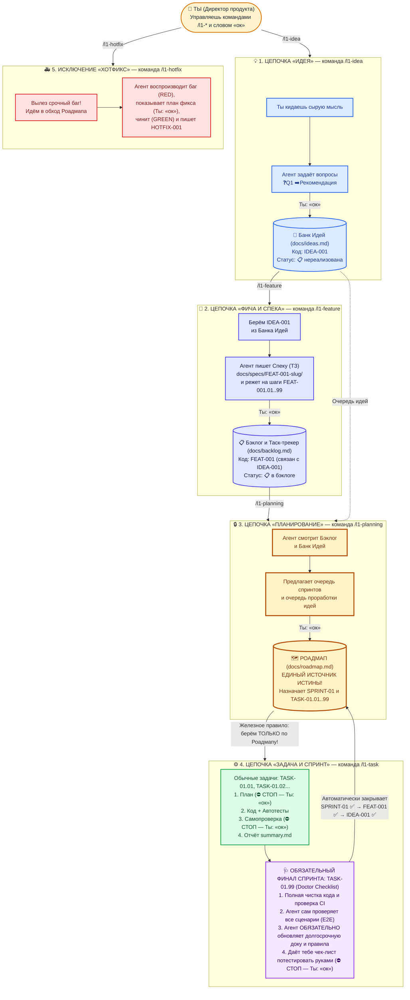
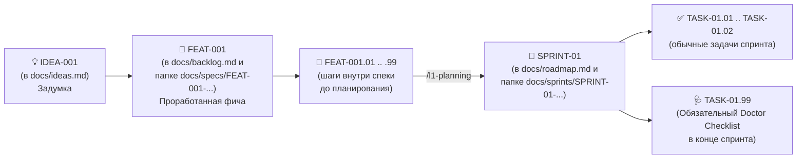

# 🚀 L1DDER — Путеводитель для человека (Vibe-Coder Friendly)

Добро пожаловать в **L1DDER**!
Это руководство написано человеческим языком — без заумной теории. Даже если ты не пишешь код руками и управляешь разработкой через диалог с ИИ («вайбкодишь») в **Cursor, Claude Code, Codex, Windsurf, Copilot или OpenCode**, за 3 минуты ты поймёшь, как строить сложные, надёжные продукты, которые не разваливаются на третий день.

---

## Навигация по руководству

| Документ | О чём он | Время чтения |
|----------|----------|:------------:|
| **[0. Главная карта (ты здесь)](/guide)** | Суть метода, **главная схема цепочек**, схема сквозных номеров (ID) и 3 экрана управления | 3 мин |
| **[1. Быстрый старт и живой пример](/quickstart)** | Установка одной командой `npx l1dder init` + реальный диалог от первой идеи до готового спринта | 5 мин |
| **[2. Подробный разбор кнопок `/l1-*`](/flows)** | Что внутри `/l1-onboard`, `/l1-idea`, `/l1-feature`, `/l1-planning`, `/l1-task` (и `Doctor Checklist`) и `/l1-hotfix` | 7 мин |
| **[3. Шпаргалка на 1 экран и FAQ](/cheatsheet)** | Таблица «Что нажать, если...», все статусы и ответы на частые вопросы | 2 мин |

---

## Зачем вообще нужен `L1DDER`?

В обычном вайбкодинге всё начинается весело: ты пишешь *«Сделай мне приложение»*, ИИ пишет 1000 строк кода. Через 3 дня ты просишь добавить новую кнопку — и половина старых функций ломается, а ИИ забывает, о чём вы договаривались вчера.

В **L1DDER** роли чётко разделены:
- 👤 **Ты — Директор продукта (Product Owner) и Главный приёмщик.** Ты придумываешь идеи, выбираешь приоритеты, говоришь **«ок»** на развилках и проверяешь готовый результат глазами.
- 🤖 **ИИ-агент — Твоя инженерная команда со встроенным техлидом.** Он сам задаёт тебе правильные вопросы с готовыми рекомендациями, сам пишет техзадания (спеки), сам пишет минимальный чистый код, сам тестирует его и сам ведёт документацию.

Для управления всем этим тебе нужны всего **6 слэш-команд (кнопок)** в чате твоего агента:
0. `/l1-onboard` — один раз на старте проекта: настроить стек и создать базовую документацию.
1. `/l1-idea` — записать и развить идею.
2. `/l1-feature` — превратить идею в чёткое ТЗ (спеку) и нарезать на задачи в Бэклог.
3. `/l1-planning` — расставить очередь в Роадмапе (что делаем сейчас, а что потом).
4. `/l1-task` — скомандовать агенту «Делай следующую задачу по Роадмапу!».
5. `/l1-hotfix` — экстренная кнопка «Срочно почини баг вне очереди!».
*(Плюс сервисная кнопка `/l1-evo` — если захочешь доработать саму методологию по принципу догфудинга или сохранить файл передачи контекста `HANDOFF.md`).*

---

## 🗺 Главная схема `L1DDER`: 5 рабочих цепочек

Посмотри на эту схему — это весь процесс работы над проектом от первой мысли до готового продукта:

---

## 🔗 Железная связка номеров (ID): почему агент никогда ничего не забудет

Чтобы даже самая простая модель ИИ никогда не запуталась, в `L1DDER` всё связано через сквозные номера — **как матрёшка**. Каждый следующий документ хранит внутри себя номера всех своих родителей:

**Что это даёт тебе на практике:**
Когда ты закрываешь последнюю задачу спринта (`TASK-01.99`), агент по цепочке номеров **сам автоматически** ставит галочки `✅ реализована` и спринту `SPRINT-01` в Роадмапе, и фиче `FEAT-001` в Бэклоге, и исходной идее `IDEA-001` в Банке Идей!

---

## 📺 Три главных файла-экрана, куда тебе нужно заглядывать

Тебе не нужно лазить по десяткам папок с кодом. Вся картина твоего проекта всегда перед глазами в **3 файлах** внутри папки `docs/`:

| Файл | Что это простыми словами | Какая команда им управляет |
|------|--------------------------|----------------------------|
| **`docs/ideas.md`** | **💡 Банк Идей.** Твоя записная книжка всех задумок с приоритетами (`P0`..`P3`) и статусами (`📋 нереализована`, `🚧 реализация`, `✅ реализована`, `❌ отклонена`). | `/l1-idea` |
| **`docs/backlog.md`** | **📋 Таск-трекер (Бэклог).** Таблица всех проработанных фич (`FEAT-001`), их спринтов, задач и журнал срочных починок (`HOTFIX-001`). | `/l1-feature`, `/l1-task`, `/l1-hotfix` |
| **`docs/roadmap.md`** | **🔒 Роадмап (Источник истины).** Главный план: какой спринт делается прямо сейчас (`1 CURRENT`), какой следующим (`2 NEXT`), и какую идею следующей превращать в ТЗ. | `/l1-planning` |

> 🔒 **Главное правило `L1DDER` (Roadmap Gate):**
> Мы никогда ничего не пишем в код «просто так с голоса». Если чего-то нет на первой строчке Роадмапа (`docs/roadmap.md`) — агент откажется это делать и предложит сначала обновить Роадмап через `/l1-planning`. Единственное исключение — срочная починка сломанного через `/l1-hotfix`.

---

👉 **Дальше:** открой **[01-QUICKSTART.md](/quickstart)**, чтобы посмотреть, как это работает на живом примере диалога!
